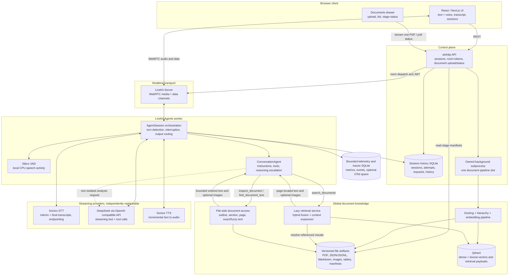
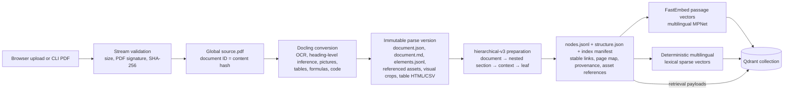
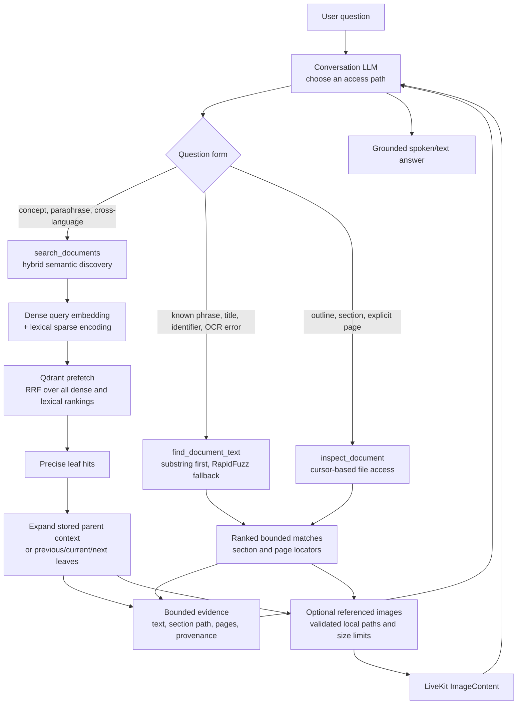

# OpenTalk

OpenTalk is a browser-based, realtime voice-assistant stack. It combines WebRTC transport, a native
LiveKit Agents session, independently replaceable streaming ASR / LLM / TTS providers, extensible agent
capabilities, and durable session history. The repository includes a text-only agent entry point,
a local microphone console, a minimal React/Next.js web client, versioned Docling PDF parsing,
hierarchical hybrid RAG over a global PDF library, Docker Compose packaging, and offline
verification tools.

The generic conversation agent is the default runtime. New business capabilities can be added
through the agent factory without rewriting transport or session persistence.

---

## Demo Video
This video shows an earlier version of the demo.

https://www.youtube.com/watch?v=qIVQs0rmlEs

## 1. What OpenTalk is

- A streaming speech pipeline: microphone audio -> VAD/STT -> agent -> LLM/tools -> TTS -> browser
  playback, with interim text and cancellation.
- A reusable `ConversationAgent` with scoped reasoning escalation and guarded tool execution.
- Provider factories for Soniox streaming STT, OpenAI-compatible streaming Chat Completions, and
  Soniox streaming TTS. Each provider is configured independently and returns a native LiveKit
  plugin instance.
- A local CPU Silero VAD used for speech activity, endpointing support, and barge-in.
- Independent SQLite stores for resumable session history and bounded telemetry / traces.
- A minimal Next.js client that connects directly to LiveKit, supports text and voice modes, shows
  transcripts and a waveform, provides a PDF upload/status drawer, and talks to a same-origin
  session-control API.
- A staged PDF pipeline that preserves the original file, versioned Docling artifacts, structural
  elements, referenced visuals, table exports, hierarchical nodes, and per-stage manifests.
- Agentic document retrieval with local multilingual dense embeddings, deterministic lexical sparse
  vectors, Qdrant reciprocal-rank fusion, parent/neighbor context expansion, and optional image
  evidence for the multimodal LLM path.
- Local and Docker startup paths, component-level smoke tools, offline tests, and optional live
  integration tests.

The rest of this document describes the task, architecture, design choices, incremental development
path, implementation lessons, future work, and how to configure and run the project.

---

## 2. Talkbot task: functional and non-functional requirements

A talkbot is not just speech recognition followed by a chat response. It must maintain a realtime
conversation, decide when the user has finished speaking, orchestrate tools, stream text and audio
concurrently, react to interruptions, and persist enough state for a coherent multi-turn experience.

### 2.1 Functional requirements

| Area | Requirement |
| --- | --- |
| Conversation | Natural multi-turn voice or text interaction, with concise spoken-style answers. |
| Streaming | ASR, LLM output, and TTS audio stream independently; playback can start before the full answer is generated. |
| Turn handling | Detect start/end of user speech and avoid sending partial ASR hypotheses to the LLM. |
| Interruption | A user can barge in while the assistant is speaking; the obsolete response and queued audio stop, but already committed business work remains consistent. |
| Multilingual input | Preserve Chinese/English and code-switched content within an utterance and across turns. |
| Language preference | Track an optional `preferred_response_language` and apply it to later assistant output/TTS where supported. |
| Tools | Allow the model to inspect data and perform constrained business actions with structured arguments when new capabilities are registered. |
| PDF knowledge | Upload global PDFs, parse text and non-text elements, preserve document structure and provenance, and expose stage status independently of conversations. |
| Document retrieval | Let the agent decide when to search, form a standalone query plus an optional alternate wording, and answer from page-located text or image evidence. |
| Persistence | Keep resumable conversation history and user data separate from bounded diagnostics and business records. |
| Traces | Record model/tool/session events and optional OpenTelemetry spans for debugging and latency analysis. |
| Frontend | Minimal browser UI for text chat, voice capture, playback, transcript, connection state, and session selection. |

### 2.2 Non-functional requirements

| Area | Requirement and current design response |
| --- | --- |
| Latency | Use streaming plugins, disable speculative pre-generation, keep a fast default model profile, and allow TTS to start as soon as text is available. |
| Interruption responsiveness | Keep the microphone open during playback; use Silero VAD plus LiveKit's native interruption handling rather than an app-level "stop audio" hack. |
| Reliability | Use explicit session attempts, heartbeats, leases, stale-response checks, transactional writes, and idempotent request keys. |
| Observability | Record native model metrics, tool outcomes, usage, and optional OTel spans without unbounded logging of private audio or full prompts. |
| Replacability | ASR, LLM, and TTS are selected by configuration and wrapped in small factories. Business logic does not import voice or model SDKs. |
| Portability | Run as a text agent, local Python services, or a Docker Compose stack. The browser only receives short-lived room tokens. |
| Resource bounds | Bounded conversation context, bounded diagnostic queues, telemetry retention, and a maximum session duration. |
| Inspectability | Keep parse, hierarchy, vector-index, and failure manifests readable on disk so every stage can be evaluated without running the full agent. |
| Privacy | Provider credentials stay on the backend. The browser receives no model or LiveKit API secrets. |
| Maintainability | Small modules, native framework interfaces, offline component tests, and optional paid live tests. |
| Current scale | Optimised for a local, single-user deployment with SQLite and an in-process worker. Cloud concurrency and multi-tenancy are future work. |

---

## 3. Architecture, technology choices, and internal design

### 3.1 Architecture diagrams

The running system has three cooperating paths: realtime conversation, session/document control,
and document knowledge. PDF data is global to the deployment rather than owned by a conversation
session.



The ingestion path keeps parsing, hierarchy preparation, and vector persistence independently
inspectable:



At query time the agent controls retrieval, while the retrieval service keeps ranking and context
assembly deterministic:



### 3.2 Core technology choices and why they were made

#### LiveKit as the realtime framework

LiveKit provides the room, WebRTC transport, media routing, data channel, participant lifecycle, and
native LiveKit Agents primitives. The Python `AgentSession` composes STT, LLM, TTS, VAD, turn
detection, output routing, tool execution, and interruption handling behind one session abstraction.
This avoids building a custom WebSocket audio protocol, jitter buffer, playback queue, and barge-in
state machine.

The browser stack is also native to LiveKit: `livekit-client` and `@livekit/components-react` can use
the same room model, participant audio, data messages, and RPC controls as the server. LiveKit Server
can dispatch a named agent into a newly allocated room, so the frontend does not need custom media
signalling.

#### Soniox for streaming STT and TTS

Soniox offers low-latency streaming speech-to-text and text-to-speech APIs with native LiveKit
plugins. The STT path returns interim and final segments, supports endpointing and language hints,
and can preserve mixed Chinese/English text. The TTS path accepts incremental text, buffers it at a
sentence-like boundary, and returns PCM audio while generation is still in progress. Long answers
are divided into bounded provider requests at Unicode character boundaries, preferring sentence or
word breaks. This keeps each request below the provider's audio-duration limit while LiveKit treats
the resulting frames as one response and waits for actual playout before completing it.

Using one provider for STT and TTS also keeps credential and operational complexity low for the
reference deployment. The providers are not hard-wired: any LiveKit-compatible STT or TTS plugin
that satisfies the same streaming contract can be substituted. Multilingual quality, language
identification, code-switch handling, pronunciation, and latency are properties of the chosen
provider and model, not guarantees of the orchestration layer.

#### OpenAI-compatible DeepSeek for the LLM

The default LLM profile uses `deepseek-flash` at `https://api.deepseek.com` through an
OpenAI-compatible Chat Completions endpoint. DeepSeek is a practical low-latency default for
streaming text and tool calls, and the OpenAI-compatible interface keeps the application portable
across many providers. `config/llm.toml` controls base URL,
model, credential variable, temperature, token limit, timeout, and provider-specific `extra_body`
options.

The default profile disables thinking (`thinking.type = "disabled"`) so ordinary responses start
quickly. A separate reasoning profile can be enabled for an isolated stronger analysis request, as
described in the escalation section below. Any replacement model must support streaming and tool
calls; provider-specific options must be checked rather than assumed.

#### Silero VAD

Silero VAD runs locally on CPU through the LiveKit plugin. It is inexpensive, has no network round
trip, and is sufficient to detect speech start/stop and trigger interruption. LiveKit uses the VAD
signal together with STT endpointing: STT determines the text content and completed turn, while VAD
helps detect user speech while the assistant is speaking. This combination keeps interruption
latency low without sending extra audio to a dedicated service.

#### SQLite stores

Session history and bounded diagnostics use separate SQLite files. This gives the
reference deployment a zero-ops persistence model with transactions, stable IDs, and simple local
backups; the session and telemetry stores enable WAL. The separation is intentional:

- session history is needed for resume and prompt context;
- telemetry/traces are bounded diagnostics that can be dropped by retention policy.

SQLite is not the target for high-concurrency cloud deployment; the future-work section discusses
the changes that would be required for that environment.

#### React / Next.js frontend

The web client is a minimal Next.js application built on the LiveKit browser starter patterns. It
uses native LiveKit components and RPCs for text and voice modes, so it is naturally compatible with
the LiveKit Server and agent worker. Next.js route handlers proxy control-plane calls to the local
session API, which prevents the browser from speaking directly to an internal API and keeps server
secrets out of the client bundle.

#### Docling for structure-aware PDF parsing

Docling is used because the retrieval corpus needs more than plain extracted text. Its document
model exposes headings, hierarchy, content layers, page/bounding-box provenance, pictures, tables,
formulas, code, and enrichment metadata through one local pipeline. The current configuration uses
OCR, accurate TableFormer structure extraction, picture description/classification, formula
enrichment, and code enrichment. Remote Docling services are disabled; models run locally and are
cached between runs.

Docling receives one shared accelerator policy with `device = "cuda"` by default, so supported
layout, table, enrichment, and picture-description models, including the inline VLM, use the
selected CUDA device. The threaded PDF backend renders pages on four parser threads, while the
standard pipeline overlaps its OCR, layout, and table stages through bounded queues and processes
pages in configurable batches. Picture descriptions are batched separately. These settings improve
throughput within one document while the application keeps one document-processing job at a time to
bound CPU, GPU, and model memory use.

PDF heading depth is recovered with Docling's `HeadingHierarchyOptions`. Bookmarks take precedence,
then numbering, then visual style; parsed PDF pages are retained during conversion so the style
signal is available. The inferred `SectionHeaderItem.level` is saved in `document.json` and
`elements.jsonl`, and `hierarchical-v3` consumes it without adding a separate heading heuristic.
Incorrect source headings can still produce an imperfect tree, so parse versions and structure
catalogs remain inspectable and immutable.

Default parsing capacity is 1,000 pages, 500 MiB, and two hours of Docling processing. The parser
keeps Docling's conversion status and page counts until validation: only `success` with every source
page processed can produce a completed manifest. A timeout returns `partial_success`; it is recorded
as a failed parse with source/processed page counts and bounded structured errors instead of allowing
the available prefix to proceed into indexing and retrieval.

Images use Docling's `REFERENCED` export mode. The JSON and Markdown artifacts therefore refer to
separate image files instead of embedding large base64 payloads, which keeps artifacts reviewable
and lets retrieval attach only the images needed for one answer. Tables are additionally exported as
HTML and CSV, so their structure can be inspected independently and their CSV content can be indexed
as text. The raw Docling JSON is retained because the simplified `elements.jsonl` view is an indexing
contract, not a replacement for the parser's complete output.

#### FastEmbed and multilingual MPNet

Dense vectors are produced locally on CPU through FastEmbed with
`sentence-transformers/paraphrase-multilingual-mpnet-base-v2`. A multilingual model matches the
Chinese/English conversation target and supports cross-language semantic retrieval without sending
document text to a separate embedding API. Document and query embedding use the provider's distinct
passage/query methods. Token counts and vector dimensions are validated before storage; oversized
chunks fail visibly instead of being silently truncated.

Embedding model, preparation profile, and collection names are versioned configuration. Changing an
embedding space requires a new profile or collection so vectors from incompatible models cannot be
mixed accidentally.

#### Qdrant for hybrid vector retrieval

Qdrant stores one named cosine dense vector and one named sparse lexical vector per indexable leaf.
It was selected because the same collection can filter structured payloads and fuse multiple dense
and sparse prefetch rankings with reciprocal rank fusion (RRF). Dense retrieval handles paraphrases
and cross-language meaning; lexical retrieval preserves exact identifiers, names, formula tokens,
and terminology that semantic embeddings can miss.

Each point also carries the leaf text, a bounded parent snapshot, neighbor IDs, section path, pages,
bounding-box provenance, parse/index/embedding versions, and asset references. This duplicates a
small amount of file-derived metadata intentionally: one Qdrant hit contains enough information for
normal context expansion, while immutable file artifacts remain the inspectable source for parsing
and visual assets.

#### RapidFuzz for deterministic text location

Hybrid retrieval remains the semantic discovery path. Exact wording, identifiers, section titles,
and small OCR or spelling errors use a separate file-side path so dense/RRF ranking cannot displace
an addressable match. The service applies Unicode NFKC, case, and whitespace normalization before
falling back to RapidFuzz local alignment. Exact matches rank above approximate matches; overlap
duplicates and per-section repetition are bounded before results enter model context.

#### Filesystem artifacts and manifests

PDF originals, parse outputs, prepared nodes, and stage manifests remain files under a global
content-hash directory; vector values live in Qdrant. This split follows the data's access pattern:
large parser outputs and images are easy to inspect, diff, mount, and preserve as files, while the
vector database handles ranked search and metadata filtering. Every parse is immutable and every
preparation/embedding run names its profile, which allows side-by-side experiments without
overwriting earlier evidence. Manifests and JSONL indexes use atomic replacement, while stable
vector IDs make retries safe.

### 3.3 Streaming ASR + LLM + TTS orchestration

The realtime path is designed around native LiveKit AgentSession nodes rather than several
application-managed queues:

1. The browser publishes microphone audio into a LiveKit room.
2. The agent worker subscribes to that audio and feeds it to the configured STT plugin. Audio also
   flows through Silero VAD in parallel.
3. Soniox STT emits interim hypotheses and final transcript segments. Interim text is used for live
   display, but the agent does not invoke the LLM for every partial hypothesis.
4. Turn detection is configured as `stt`: endpointing decides when the user has finished a turn.
   `preemptive_generation` is disabled, so there is no speculative generation from incomplete text.
5. The completed user turn enters the LLM node. `ConversationAgent.llm_node` trims the chat context,
   adds trusted runtime context (current UTC date/time), applies the preferred
   reply language, and then calls the native streaming LLM.
6. The LLM streams content chunks. If it emits a tool call, LiveKit executes the registered tool
   handler, appends the tool result to the model context, and continues the same agent turn up to the
   tool-step limit configured in `config/voice.toml`.
7. Assistant text chunks are emitted to the output path. The TTS node receives the same stream
   incrementally; the Soniox plugin buffers text at a sentence-like boundary and returns audio frames
   over its WebSocket while text generation is still running. When a reply exceeds
   `max_request_bytes`, the node completes the current provider request and continues with another
   request over the persistent connection; it does not discard the remaining text.
8. Audio frames are written into the LiveKit room and played by the browser. Text output is also
   available for the transcript and can be used without audio in text mode.

Because each stage is a streaming native node, first audio does not wait for the complete LLM answer.
The exact amount of overlap visible in a short utterance depends on model latency and text length; a
multi-sentence answer is the clearest way to observe audio-before-input-end behaviour.

### 3.4 Why this design supports barge-in natively

Barge-in is a first-class session event in this design:

- The user's microphone remains open while assistant audio is playing.
- Incoming speech is visible to both STT and Silero VAD.
- LiveKit is configured with interruption mode `vad`, a short `min_interruption_duration`, and
  `resume_false_interruption = false`.
- When sustained user speech is detected, the active `SpeechHandle` is marked interrupted. The
  framework cancels the current LLM generation and TTS stream, stops further text from being
  synthesized, and discards audio that has not yet been played.
- The new user speech is handled as a new turn. The interrupted response cannot keep appending to the
  new answer or revive a stale tool call.

The generic agent provides a guarded execution helper for future tools. Calls that become stale
before execution are rejected. Already-started work is shielded from speech cancellation;
new integrations must implement their own transactions, ownership checks, and idempotency.

In short, barge-in works because one realtime session owns the input audio, model streams, TTS output,
and playback queue. Stopping an obsolete answer is coordinated by the session, not by an out-of-band
application command.

### 3.5 Agent and capability composition

`ConversationAgent` owns language preferences, runtime context, stale-response validation,
reasoning escalation, document retrieval, and guarded tool execution. `voice/factories.py`
currently registers only `conversation` and injects process-owned retrieval and document-access services. Add a service adapter
and agent tools there when introducing a new business. Session storage, document storage, and
browser controls remain independent of business implementations.

`escalate_reasoning(task, message)` performs one isolated, tool-free analysis per user turn. The
conversation model supplies a short, context-specific progress notice in `message`; the runtime
checks it against the current turn's response language before speaking it unchanged. The same
language constraint is repeated for the main model before and after tool calls and for the reasoning model.
It returns the conclusion to the normal agent without changing the default model profile.
`search_documents(query, alternate_query, document_id, max_results, include_images)` returns
grounded semantic evidence from the global PDF corpus. `inspect_document` browses one document's
outline or reads a bounded section/page range with a continuation cursor. `find_document_text`
performs normalized substring or fuzzy lookup in one document, optionally constrained by section
or page. All tools run within the current turn's stale-response guard; blocking file, model, and
database work runs in a worker thread rather than on the realtime event loop.

### 3.6 Session and trace persistence

OpenTalk deliberately separates two kinds of state:

| Store | Contents | Persistence style |
| --- | --- | --- |
| Session database | Sessions, attempts, idempotent allocation requests, native conversation history, userdata | Durable conversation state with resume semantics. |
| Telemetry / tracing database | Model metrics, session events, tool outcomes, usage, optional OTel spans | Bounded diagnostics with retention and event-count limits. |

The session store tracks a logical `session_id` and a per-run `attempt_id`. A session can be
`pending`, `active`, `completed`, or `failed`. Only normally `completed` sessions are resumable. A
resume creates a new attempt and a new room name while preserving the logical conversation ID.
Requests are idempotent, workers renew a heartbeat/lease, abandoned pending allocations expire, and
the maximum session duration is bounded.

Conversation history is serialised from LiveKit's native `ChatContext` using stable native item IDs.
Audio, images, metrics, and configuration updates are excluded. `SessionState` is stored as userdata
and currently contains `session_id`, `attempt_id`, and `preferred_response_language`. The journal
checkpoints after a conversation item is committed, with a short coalescing delay, and also on
heartbeat and normal shutdown. Restoring a session feeds the saved history back into a new agent
instance; old tool results provide context only and are not re-executed.

The session database has a small explicit schema: `sessions` stores the logical session, current
attempt, mode, room, status, and userdata; `attempts` stores per-run ownership, heartbeat, status,
and errors; `requests` makes allocation idempotent; and `history` stores serialised native
`ChatContext` items keyed by `(session_id, item_id)` with an ordering position.

The telemetry store uses a single bounded table,
`telemetry(event_id, session_id, attempt_id, kind, timestamp, payload_json)`, and upserts stable
IDs, so repeated checkpoints are safe. It contains model metrics, `response_started` /
`response_finished`, tool outcomes, errors, usage, and other bounded session events. Optional
tracing (`tracing_enabled` in `config/sessions.toml`) uses LiveKit's OpenTelemetry integration and a
SQLite span exporter. Content sharing is disabled for spans, and the resulting trace records
capture trace/span IDs, parentage, status, duration, and non-PII attributes. Tracing is disabled by
default.

Resumable history is not capped by diagnostics retention. Diagnostics can be trimmed or dropped
without affecting the user's conversation.

### 3.7 Web frontend

The frontend is a small Next.js and React application using the native LiveKit browser stack:

- `livekit-client` handles the WebRTC connection, microphone track, playback, data-channel
  messages, and RPC calls.
- `@livekit/components-react` provides session and agent hooks and audio visualisation components.
- The UI supports a text mode and a voice mode. Text uses LiveKit's native `lk.chat` stream; voice
  mode enables the microphone and uses a small RPC (`opentalk.set_voice_mode`) to switch output
  behaviour.
- Transcript messages follow native segment IDs, so interim revisions replace the same visible
  message instead of accumulating duplicates.
- A lightweight service panel checks the session API, LiveKit server, worker health, and provider
  configuration presence without calling paid provider APIs.
- Session selection, history, automatic save/close, resume, and terminal-session deletion are handled through the control API.
- A left-side document drawer streams one PDF upload, lists global documents, polls the Parse,
  Structure, and Vectors manifests, and deletes completed or failed documents after confirmation.
- Next.js route handlers proxy control-plane requests to the internal session API, and the browser
  receives only a short-lived LiveKit JWT. Provider keys and LiveKit API secrets never reach the
  client bundle.

The minimal client connects to the same LiveKit Server,
AgentSession, and providers as the backend command-line paths.

### 3.8 UI/UX design and information hierarchy

The interface uses a deliberately minimal visual language: a restrained neutral palette, compact
controls, generous whitespace, and one conversation-focused workspace. Shared semantic color
tokens adapt automatically to the browser's light or dark color scheme, so panels, text, borders,
hover states, success states, and errors remain legible without maintaining two separate layouts.
The same structure scales down to mobile instead of introducing a different interaction model.

The information hierarchy follows progressive disclosure. State that helps a user decide whether
the product is ready remains visible at the point of action: document cards show queued, Parse,
Structure, Vectors, ready, and failed states; the toolbar summarizes service availability; and the
conversation composer reports connection, listening, thinking, speaking, and saving states. Voice
mode adds an animated waveform and an explicit state label, providing immediate feedback that the
voice path is listening or responding. Interim speech revisions and streamed assistant text update
the transcript in place, which lets users verify recognition and answers while processing continues.

Implementation details that do not help the next user decision stay hidden. The UI does not expose
tool calls, reasoning internals, queue ownership, embedding work, retrieval ranks, leases, or raw
provider diagnostics in the conversation. Documents, recent sessions, and detailed service checks
are closed by default and opened on demand. This keeps history and operational controls available
without competing with the active conversation; errors surface only when they affect an action the
user can understand or retry.

### 3.9 PDF ingestion and versioned artifacts

Documents are deployment-global and deliberately have no `session_id`. The browser posts one
multipart PDF through the same-origin Next.js proxy to the aiohttp control API. The API streams the
body to a staging file in 1 MiB chunks while enforcing the configured byte limit, checking the PDF
signature, and calculating SHA-256. The digest becomes the stable `document_id`; an identical ready
document is reused rather than parsed and indexed again.

Accepted uploads are handed to an owned subprocess instead of running Docling or FastEmbed on the
aiohttp event loop. The reference deployment uses one processing slot because Docling and embedding
models are memory-intensive. The API returns after queueing and reconstructs document status from
the stage manifests, supplemented by in-process queued/processing state before the first manifest
exists. Closing the API terminates subprocesses it owns.

Deletion is limited to stable lifecycle points. Active or pending sessions must be ended first, and
queued or processing documents return a conflict. A document delete removes every Qdrant point with
that `document_id` before removing the content-hash directory, so a vector-store failure leaves the
file artifacts available for a retry. Session deletion removes its history, attempts, allocation
requests, and bounded telemetry.

The file layout is intentionally explicit:

```text
data/documents/<sha256>/
  source.pdf
  parses/<docling-version_timestamp_suffix>/
    manifest.json
    document.json
    document.md
    elements.jsonl
    assets/
    visuals/
    tables/*.html
    tables/*.csv
    indexing/<index-profile>/
      index_manifest.json
      nodes.jsonl
      vector_indexes/<embedding-profile>/manifest.json
```

`manifest.json` records the parser version, settings, timestamps, element counts, outputs, warnings,
and failure information. `elements.jsonl` provides stable per-parse element IDs, Docling
parent/child links, labels, heading levels, content layers, page geometry, text, enrichment metadata,
annotations, and asset paths. The original PDF and all parse/intermediate outputs stay on the
filesystem; Compose
uses a host directory mount for them, a named model cache, and a separate Qdrant volume.

### 3.10 Hierarchical preparation and vector indexing

Index preparation is deterministic and database-independent. It reads one completed parse and
builds a hierarchy with four practical levels:

1. one non-indexable document root;
2. nested section nodes from Docling titles and section headers;
3. bounded context parents that group adjacent content within a section;
4. indexable leaves for text chunks and non-text evidence, with table leaves split again when
   necessary.

Text leaves include their heading path in `embedding_text`, while their returned `text` remains the
content itself. Chunks prefer punctuation/whitespace boundaries, overlap by a configured amount,
and carry source element IDs, pages, bounding boxes, previous/next links, and referenced assets.
Docling-labelled furniture, page headers, and page footers are excluded together with their
descendants. No position-, repetition-, image-hash-, or classifier-based heuristic removes content,
because false deletion is harder to recover from than retrieval noise.

Non-text elements participate from the start of the pipeline:

- Pictures retain referenced image files. Only semantic fields such as captions, descriptions,
  summaries, keywords, topics, entities, enriched code/molecule text, and chart titles enter the
  embedding text; provider/model names, classifier candidates, confidence values, and generation
  control tokens do not.
- Tables use exported CSV text for searchable chunks and retain HTML/CSV/visual references. The
  full bounded table content can be returned as parent context.
- Formulas and charts use Docling text, enrichment metadata, and annotations when available. Their
  visual references remain available for multimodal inspection.

Only nodes marked `indexable` are embedded. Each leaf receives a FastEmbed dense vector and a
deterministic Unicode-aware sparse vector: Han runs generate character unigrams and bigrams, while
other alphanumeric runs generate normalized word-like tokens. Qdrant applies IDF to the sparse
space. UUIDv5 point IDs are derived from document, parse, index, embedding profile, and node IDs, so
repeating the same vectorization run upserts the same logical points. The run manifest verifies the
stored point count and records failures without appending duplicate JSONL records.

### 3.11 Agentic hybrid retrieval and multimodal evidence

Retrieval is agentic at the decision and query-planning boundary. The conversation model decides
whether uploaded documents are relevant and calls `search_documents`; it converts the current turn
and useful conversation context into a standalone query, and may add one alternate wording or exact
term variant. This keeps query transformation aware of dialogue intent without adding another model
call to every retrieval. The current implementation has no separate query router or unconstrained
multi-query generator.

Each LiveKit job process starts FastEmbed preload in a background thread and reuses that service
across sessions. Process startup and room connection therefore do not wait for local model and ONNX
initialization. If a document query arrives before preload finishes, it waits for and reuses the same
initialization rather than loading a second model. The warmup does not require a Qdrant collection,
so a new installation can still start before its first document is indexed; schema and embedding-space
validation remain part of the first actual search. For every
query variant it creates one dense and one lexical query, asks Qdrant for bounded candidates, and
uses RRF across all rankings. Optional filters can restrict document ID, parse version, index
profile, and embedding profile.

Search targets precise leaves, but answers usually need more context. Each hit therefore expands to
its stored bounded parent. If no parent text exists, retrieval fetches the previous and next indexed
leaves and returns a surrounding window. Evidence remains bounded and contains both the exact match
and expanded context, plus rank, score, node type, section path, pages, provenance, and asset
references. There is currently no cross-encoder reranker; hybrid RRF plus hierarchy expansion keeps
the first implementation local, inspectable, and independently testable.

Tables, formulas, charts, and picture descriptions enter the normal textual tool result. When the
agent sets `include_images`, referenced image files are resolved beneath the immutable parse root,
checked for supported MIME type and size, base64-encoded as LiveKit `ImageContent`, and attached to
the next LLM step for multimodal reasoning. Image count and bytes are capped. Local paths are never
returned in the normal agent tool payload.

The corpus is global and currently has no tenant ACL or per-session selection state. That matches
the local single-user scope; authentication, document ownership, and access-filtered retrieval are
required before a multi-user deployment.

### 3.12 Module internals worth knowing

```text
backend/opentalk/
  agents/base.py              Generic ConversationAgent: session hooks, language, stale checks,
                              reasoning escalation, tool execution guard.
  voice/session.py            Builds and runs the native AgentSession from configured providers,
                              VAD, histories, persistence, and interruption settings.
  voice/worker.py             LiveKit room worker and job/service lifecycle.
  voice/text.py               Text-only console with session commands.
  voice/room_control.py       Browser voice/text RPC and audio-mode controls.
  voice/factories.py          Agent composition boundary.
  asr/provider.py             Soniox STT factory and public config.
  llm/provider.py             OpenAI-compatible LLM factory and optional reasoning profile.
  tts/provider.py             Soniox TTS factory and public config.
  sessions/store.py           Sessions, attempts, requests, history, leases.
  sessions/tracing.py         Optional OpenTelemetry-to-SQLite exporter.
  sessions/telemetry.py       Bounded event/metric storage.
  sessions/api.py             Control API for session/document lifecycle and status.
  documents/parser.py         Docling PDF parsing and versioned file artifact export.
  documents/parse.py          Manual PDF parsing command-line entry point.
  documents/indexing.py       Hierarchical index preparation without embeddings or a database.
  documents/prepare_index.py  Manual index-preparation command-line entry point.
  documents/embedding.py      Local embedding provider contract and FastEmbed adapter.
  documents/lexical.py        Deterministic multilingual sparse-vector encoding.
  documents/vector_store.py   Qdrant schema, idempotent upsert/delete, filtering, and raw search adapter.
  documents/vector_index.py   Prepared-node embedding, retrieval payload, and run manifest.
  documents/index_vectors.py  Manual vector-indexing command-line entry point.
  documents/search_vectors.py Raw dense-search command for stage-level quality checks.
  documents/retrieval.py      Hybrid RRF retrieval, parent/neighbor expansion, image resolution.
  documents/retrieve.py       Manual end-to-end retrieval command-line entry point.
  documents/pipeline.py       Parse, prepare, and vector-index composition boundary.
  documents/library.py        Global artifact listing and owned processing subprocesses.
  documents/process.py        Complete uploaded-document command-line entry point.
frontend/
  app/ and components/        LiveKit UI, document drawer, and server-side control proxy.
config/                       Public, non-secret configuration for providers and runtime.
tests/                        Offline backend tests plus opt-in live LLM tests.
```

The most useful design rule for future talkbot work is that each subsystem has one reason to change:
providers change when model services change, the agent changes when conversation policy or tools
change, the business service changes when domain rules change, and session storage changes only when
persistence semantics change.

---

## 4. Incremental development and testing

The project was built in independently testable stages. Each stage added one capability while
preserving the interfaces used by earlier stages.

### 4.1 LLM, ASR, and TTS developed and tested separately

The LLM provider was validated with a text streaming smoke tool. Soniox ASR was validated by
replaying a local media file through the real streaming protocol and observing interim/final events.
Soniox TTS was validated by feeding incremental text and writing the received PCM stream to a WAV
file. Offline tests used simulated WebSocket transports; live smoke tests remained opt-in and paid.
No frontend, room server, or agent was required for these component checks.

### 4.2 Native text agent

The text console uses the same native AgentSession and generic agent as the voice runtime.
Test-only tools exercise streaming tool protocols and cancellation without business data.

### 4.3 Session and trace management

The session store added durable logical sessions, run attempts, leases, resumable history, and
idempotent allocation. The telemetry side added bounded model/tool/session events and optional
OpenTelemetry spans. Text console commands were added for listing, inspecting, ending, and resuming
sessions.

### 4.4 Web frontend

The minimal Next.js client was adapted from the LiveKit browser starter. It added text/voice
switching, microphone capture, playback, transcript revision handling, session controls, a service
status panel, and a same-origin control proxy. It connects directly to LiveKit Server; no custom
media protocol was introduced.

### 4.5 PDF and RAG stages

The document path was developed in data-flow order rather than behind one large abstraction.
Docling parsing was first validated by inspecting versioned JSON, Markdown, element, image, and table
artifacts. Hierarchical preparation was then tested as pure file transformation, including structure,
links, chunk bounds, provenance, and non-text semantics. Embedding/Qdrant tests verified dimensions,
token limits, stable upserts, payload filters, and point counts. Retrieval tests finally exercised
dense-plus-lexical fusion, alternate queries, parent expansion, neighbor fallback, context bounds,
and safe image resolution. The browser upload pipeline composes the same stages only after each can
be run and evaluated independently from the CLI.

### 4.6 Docker packaging

The full stack was packaged as separate API, worker, LiveKit, frontend services
with health checks, isolated named volumes, runtime-injected secrets, and an offline test profile.
The container entry points use the same Python modules and configuration as local development.

---

## 5. Challenges and design changes

### 5.1 Complex questions need more thinking without delaying the first response

Some requests need more analysis than a fast, non-thinking model should spend on the first pass.
Waiting for a long reasoning trace before saying anything would make the conversation feel
unresponsive, while always using a slow reasoning model would add latency to ordinary turns.

The current solution keeps the default profile fast and non-thinking, but gives the model an
`escalate_reasoning` tool. When the model judges that a question is difficult, it can:

1. generate a short, context-specific acknowledgement in the user's response language;
2. send a self-contained task and relevant facts to one isolated, stronger analysis request;
3. receive only the conclusion;
4. continue with the default profile and its registered tools.

Escalation is limited to once per user turn, and it does not mutate shared provider settings.

This is a pragmatic solution for this workload. If the default model were slower, a small, fast
router could be used to select model strength or reasoning level from question complexity. If a task
were extremely complex, long-running, or concurrent, a background sub-agent could be started through
a tool call and its result delivered later. Those remain tool-orchestration patterns rather than
changes to the transport architecture.

### 5.2 Written-style LLM output is often bad for TTS

By default an LLM may answer with Markdown tables, bullet lists, emoji, code blocks, headings, or
long written paragraphs. Those formats are poor or invalid input for many TTS systems.

The current system prompt explicitly requires short, natural, spoken-style sentences and forbids
tables, emoji, Markdown formatting, code blocks, and visual bullet lists in user-facing replies. Structured
arguments remain inside tool calls, not in spoken text. Where a prompt is not enough,
a streaming speech normaliser can transform model output into TTS-friendly text while preserving the
conversation stream.

---

## 6. Future work

### 6.1 Tone and paralinguistic understanding

The current pipeline treats speech as transcribed text. Tone, emotion, hesitation, emphasis, and
other non-textual cues are not part of the agent's decision context. Future work could add an audio
understanding tool or replace the ASR + LLM + TTS chain with a speech-to-speech multimodal model
when such a model provides the required control, latency, and tool-calling behaviour.

### 6.2 MCP for business integrations

Adding a new service currently requires a manual adapter and tool description. Supporting the Model Context Protocol (MCP) would allow
the agent to discover and call a broader ecosystem of existing tools and services. Future services can be exposed through MCP with additional authentication, capability filtering, and
auditing.

### 6.3 Background memory and retrieval evolution

The current hybrid RAG path retrieves from a global, explicitly uploaded PDF corpus. Conversation
history is stored and replayed as bounded session context, but it is not converted into long-term
memory. In a native voice application, users should not have to manage that memory explicitly;
future work includes memory extraction, summarisation, retrieval, updates and forgetting,
user-profile/privacy controls, document ownership and deletion, access-filtered collections,
cross-encoder reranking, evaluation datasets, and background re-indexing when parser or embedding
profiles change.

### 6.4 Cloud deployment and concurrency

The current implementation is designed for local, effectively single-user use. A cloud service with
high traffic would need substantially more infrastructure:

- multiple distributed worker processes and autoscaling for LiveKit Agents;
- a shared session/state store such as PostgreSQL instead of local SQLite;
- a fast coordination/cache layer for leases, active-room routing, and rate limits;
- object storage for long transcripts, recordings, traces, and large artifacts;
- multi-tenant authentication, authorisation, quotas, and data-isolation controls;
- provider rate-limit handling, retries, fallback providers, and observability at fleet scale;
- highly available LiveKit and media network design rather than a local development server;
- secret management, audit, privacy/compliance controls, and CI/CD;
- load and soak testing for ASR/TTS concurrency rather than per-session correctness tests alone.

---

## 7. Configuration and startup

### 7.1 Requirements

| Component | Requirement |
| --- | --- |
| Python | Python 3.11 and `uv`; use `uv.lock` and `uv sync --locked --python 3.11`. |
| Frontend | Node.js 24 and pnpm 10.13.1; use `frontend/pnpm-lock.yaml`. |
| LiveKit | A local `livekit-server` binary or the Docker Compose service. The local config uses `devkey` / `secret`. |
| Provider credentials | `DEEPSEEK_API_KEY` for the LLM and `SONIOX_API_KEY` for ASR/TTS. Both are read from the process environment or `.env.local`; process environment variables take precedence. |
| Browser | A modern browser with microphone permission for voice mode. PortAudio and local audio devices are not required for the browser or Docker paths. |
| Docker | Docker Compose v2 for the container stack. On Windows, enable WSL integration for the project distribution. |

### 7.2 Environment file

Copy the placeholder example and fill in the provider credentials:

```bash
cp .env.example .env.local
```

The relevant variables are:

```dotenv
DEEPSEEK_API_KEY=...
SONIOX_API_KEY=...
LIVEKIT_URL=ws://localhost:7880
LIVEKIT_PUBLIC_URL=ws://localhost:7880
LIVEKIT_API_KEY=devkey
LIVEKIT_API_SECRET=secret
```

`LIVEKIT_URL` is the server URL used by Python services. `LIVEKIT_PUBLIC_URL` is the URL sent to the
browser. They can differ for remote or container deployments. Never put provider credentials or
LiveKit API secrets in `NEXT_PUBLIC_*` variables or the frontend environment.

### 7.3 Configuration map

| File | Purpose |
| --- | --- |
| `config/llm.toml` | LLM base URL, model, credential variable, default non-thinking options, and optional reasoning profile. |
| `config/asr.toml` | Soniox STT endpoint, model, language hints, sample rate, endpoint delay, and replay settings. |
| `config/tts.toml` | Soniox TTS endpoint, model, voice, primary language, sample rate, timing settings, and the per-request text bound used to avoid provider duration truncation. |
| `config/voice.toml` | LiveKit URL, agent name, VAD parameters, endpointing, and interruption duration. |
| `config/sessions.toml` | Session/telemetry database paths, heartbeat/lease limits, context size, API host/port, token TTL, and tracing switch. |
| `config/documents.toml` | Global PDF storage, parsing limits, image export, table mode, Docling enrichment switches, accelerator device, parser threads, stage batches, and queue bounds. `OPENTALK_DOCUMENT_DEVICE` can override the device for deployment. |
| `config/rag.toml` | Embedding model/profile, token and batch limits, Qdrant schema/endpoint, hybrid candidate limits, context bounds, and image limits. |
| `config/livekit-local.yaml` | Local LiveKit development server configuration for same-machine browser testing. |
| `config/docker/` | Container-specific overrides for backend and session paths. |

Relative database paths are resolved from the project root, independently of the process working
directory.

### 7.4 Parse a PDF for inspection

PDF parsing is an independent backend command. It stores the original PDF globally by content hash
and writes every parse into a separate immutable version directory. Parsing does not create
embeddings or expose retrieval to the conversation agent.

Install the optional parser dependency group without removing unrelated packages from an existing
environment:

```bash
uv sync --locked --inexact --group documents
```

Parse one local PDF:

```bash
PYTHONPATH=backend uv run --locked --group documents \
  python -m opentalk.documents.parse /path/to/document.pdf
```

The command prints the document ID, parse version and artifact paths. The default output root is
`data/documents`. Each parse contains `manifest.json`, lossless Docling JSON, readable Markdown, an
`elements.jsonl` structure/provenance view, referenced images, visual crops, and HTML/CSV table
exports. Picture descriptions, picture classification, formula recognition, code enrichment, OCR,
and accurate table extraction are enabled by default. These use local Docling models; the first run
may download model artifacts. Remote model services are disabled.

The default `[documents.acceleration]` profile selects CUDA, uses eight model threads and four PDF
parser threads, batches OCR and layout pages in groups of four, batches table pages in groups of two,
batches VLM picture descriptions in groups of four, and caps each pipeline queue at eight pages.
Rendered page images use scale 1.0 because Docling retains them until picture/table crops are
assembled; scale 2.0 caused a 629-page document to exceed 20 GiB of host memory. Use
`device = "cuda:N"` to select a particular GPU. Set `device = "auto"` for runtime selection or
`device = "cpu"` on a machine without a usable CUDA runtime. Flash Attention 2 remains disabled
because it requires a separately compatible installation; enable it only after providing that
runtime dependency.

The optional Compose tool uses bind-mounted input and output directories:

```bash
OPENTALK_DOCUMENT_INPUT_DIR=/path/to/pdfs \
OPENTALK_DOCUMENTS_DIR=/path/to/document-data \
docker compose --profile documents run --build --rm document-parser /input/document.pdf
```

The input directory is read-only. PDF originals and every parse version are written beneath the
host output directory. A separate named volume caches downloaded Docling model artifacts. The
default Compose configuration exposes all host GPUs to the parser container and requires Docker
NVIDIA Container Toolkit support. For CPU-only parsing, add `-f compose.cpu.yaml`; this removes the
GPU request and sets the parser device to CPU.

### 7.5 Prepare hierarchical indexing nodes

Run index preparation against one completed parse directory. This stage uses only local artifacts and
does not require the optional Docling dependency group:

```bash
PARSE_PATH=data/documents/<document-id>/parses/<parse-version>
PYTHONPATH=backend uv run --locked python -m opentalk.documents.prepare_index "$PARSE_PATH"
```

The output is written to `indexing/<profile>/index_manifest.json` and `nodes.jsonl` beneath that
parse version. The default `hierarchical-v3` profile creates document and nested section nodes,
bounded context parents, indexable text chunks, referenced picture/formula nodes, and table child
chunks. `structure.json` stores compact section links and page-to-node references without copying
body text. Use `--profile <new-name>` for another experiment; an existing profile is never overwritten.

Picture retrieval text uses an explicit semantic field list: caption, description, summary,
keywords, topics, entities, enriched code or molecule text, and chart title. Model/provider names,
classifier candidates, confidence values, annotation kinds, and generation control tokens are not
included. Index preparation excludes only elements that Docling labels as furniture, page headers,
or page footers, together with their structural descendants. It does not infer furniture from page
position, repetition, image hashes, or picture classification.

Validate structure and preview indexable content before adding embeddings:

```bash
INDEX_PATH="$PARSE_PATH/indexing/hierarchical-v3"
PYTHONPATH=backend uv run --locked python -m opentalk.documents.inspect_index \
  "$INDEX_PATH" --sample-size 20
```

The command exits unsuccessfully for broken parent/child links, neighbor links, empty indexable
text, manifest count mismatches, or oversized chunks. Its JSON report separately lists missing asset
paths and non-text elements that have no searchable description. Content review should compare the
sample text, section paths, pages and asset references with `document.md`, `elements.jsonl` and the
rendered PDF. Character limits are preparation bounds; the embedding stage must also validate the
chosen model's tokenizer limit.

Browse the recovered hierarchy and content without Qdrant:

```bash
PYTHONPATH=backend uv run --locked python -m opentalk.documents.query inspect \
  <document-id> --view outline
PYTHONPATH=backend uv run --locked python -m opentalk.documents.query inspect \
  <document-id> --view page --page-start 12 --page-end 13
PYTHONPATH=backend uv run --locked python -m opentalk.documents.query find \
  <document-id> "known phrase or near spelling" --match-mode auto
```

Outline results contain compact section IDs and page ranges. Section and page reads enforce a total
character budget and return `next_cursor` when more content remains. Text lookup reports the applied
match mode, score, matched span, bounded context, section path, pages, provenance, and assets.

### 7.6 Embed and persist prepared nodes

FastEmbed and the Qdrant client are runtime dependencies because the conversation worker performs
query embedding and retrieval. The `rag` group is also available for stage-specific local or
container tooling:

```bash
uv sync --locked --inexact --group rag
docker compose --profile rag up -d --wait qdrant
```

Index one prepared profile. The first real run downloads the configured local model, currently
`sentence-transformers/paraphrase-multilingual-mpnet-base-v2`:

```bash
INDEX_PATH="$PARSE_PATH/indexing/hierarchical-v3"
PYTHONPATH=backend uv run --locked --group rag \
  python -m opentalk.documents.index_vectors "$INDEX_PATH"
```

Only nodes marked `indexable` are embedded. Token counts are checked against the configured 512
token model limit before embedding, so oversized content fails instead of being silently truncated.
Points use stable IDs and can be safely upserted again. Their payloads contain the precise node,
bounded parent context, neighbor IDs, section metadata, pages, provenance, and referenced picture or
table assets. The file-side run report is written to
`vector_indexes/<embedding-profile>/manifest.json`; vector values live only in Qdrant.

Use raw dense search to inspect the embedding/vector-storage stage independently:

```bash
PYTHONPATH=backend uv run --locked --group rag \
  python -m opentalk.documents.search_vectors \
  "Which component sends requests to the agent?" \
  --document-id <document-id> --parse-version <parse-version> \
  --index-profile hierarchical-v3 --limit 10
```

Inspect result text, parent context, page numbers, scores, and asset references. Evaluate factual,
paraphrased, Chinese/English cross-language, table, formula, picture-description, and unrelated
queries as a set. This command performs dense vector search only; it intentionally bypasses the
production hybrid fusion and hierarchy expansion.

Run the complete retrieval stage manually before testing it through the agent:

```bash
PYTHONPATH=backend uv run --locked --group rag \
  python -m opentalk.documents.retrieve \
  "Which component sends requests to the agent?" \
  --alternate-query "agent request component" \
  --document-id <document-id> --index-profile hierarchical-v3 --limit 6
```

This path uses the same dense and lexical encoders, Qdrant RRF query, filters, parent/neighbor
expansion, context bounds, page/provenance payload, and referenced-image resolution as the
`search_documents` agent tool. Query transformation itself remains the conversation model's job;
the CLI accepts the already transformed primary and optional alternate queries.

The one-shot container mounts the global document directory and writes to the same Qdrant service:

```bash
OPENTALK_DOCUMENTS_DIR=/path/to/document-data \
docker compose --profile rag run --build --rm document-indexer \
  /app/data/documents/<document-id>/parses/<parse-version>/indexing/hierarchical-v3
```

Set `OPENTALK_QDRANT_URL` to override the local endpoint. Set the optional `QDRANT_API_KEY`
environment variable when the configured server requires it. The default local Compose Qdrant binds
only to loopback and stores data in the `qdrant-data` named volume.

### 7.7 Start the full local stack

Prepare the Python and frontend dependencies once:

```bash
uv sync --locked --python 3.11 --inexact --group documents
cd frontend
pnpm install --frozen-lockfile
cd ..
```

Then start the services in separate terminals from the project root:

```bash
# Terminal 0: vector database used by uploaded documents and retrieval
docker compose up -d --wait qdrant

# Terminal 1: LiveKit transport
livekit-server --config config/livekit-local.yaml

# Terminal 2: session control API and token issuance
PYTHONPATH=backend uv run --locked python -m opentalk.sessions.api

# Terminal 3: LiveKit agent worker
PYTHONPATH=backend uv run --locked python -m opentalk.voice.worker dev --no-reload --log-level info

# Terminal 4: browser client
cd frontend
pnpm dev
```

Open <http://localhost:3000> and allow microphone access. The service panel should report the session
API, LiveKit server, worker, and provider configuration as available/configured. Default ports are
LiveKit `7880`, RTC TCP `7881`, RTC UDP `7882`, session API `8080`, worker health `8081`, and frontend
`3000`.

Open **Documents** in the header to use the left drawer. It lists global PDFs and their Parse,
Structure, and Vectors stages. **Upload PDF** streams one file to the control API and returns as soon
as the job is queued; the drawer polls file-side manifests while Docling, hierarchical preparation,
and vector indexing run in order. An identical PDF that is already ready is reused by content hash.
The document store remains independent of the selected conversation and session database.

For a production-style frontend build use `pnpm build && pnpm start` instead of `pnpm dev`.

### 7.8 Docker Compose

Configure `.env.local`, then run from the project root:

```bash
docker compose up -d --build --wait
docker compose ps
docker compose logs --tail 100 worker api
```

Open <http://localhost:3000>. The stack includes LiveKit Server, Qdrant, the document-capable session
API, the agent worker, and the standalone Next.js frontend. Session, telemetry, vector data, model
caches, and the bind-mounted global document directory remain separate. The default Compose file
grants GPU access to `api` because frontend uploads are parsed by subprocesses owned by that service.
After changing GPU configuration, use `docker compose up -d --force-recreate api`; restarting an
existing container does not add a GPU DeviceRequest.

CPU-only hosts use the explicit override, which also selects the CPU parser device:

```bash
docker compose -f compose.yaml -f compose.cpu.yaml up -d --build --wait
```

```bash
# Stop the stack while preserving data.
docker compose down

# Run the backend offline test suite in isolation.
docker compose --profile test run --build --rm --no-deps backend-tests

```

See the Docker guide in `docs/` for port overrides, persistence and
media-path verification.

### 7.9 Text-only agent

The text console does not require LiveKit, ASR, TTS, a microphone, or PortAudio. It uses the same
agent and tool lifecycle:

```bash
PYTHONPATH=backend uv run --locked python -m opentalk.voice.text
PYTHONPATH=backend uv run --locked python -m opentalk.voice.text --agent conversation
```

It supports session commands such as `/session`, `/session list`, `/session history`, `/session
resume`, `/session end`, and `/quit`. A model credential is required once a normal message or a
session resume starts the agent.

### 7.10 Component smoke tests and tests

All commands below run from the project root. The smoke tests call paid provider APIs; the offline
test suite does not.

```bash
# Streaming LLM smoke test.
PYTHONPATH=backend uv run --locked python -m opentalk.llm.smoke

# Streaming ASR file replay; replace the WAV with your own recording.
PYTHONPATH=backend uv run --locked python -m opentalk.asr.replay recordings/demo.wav \
  --output logs/asr-demo.json

# Streaming TTS smoke test.
PYTHONPATH=backend uv run --locked python -m opentalk.tts.smoke \
  --text "你好，欢迎使用 OpenTalk。How can I help you today?" \
  --output recordings/tts-demo.wav --report logs/tts-demo.json

# Offline backend suite.
PYTHONPATH=backend uv run --locked pytest -q

# Explicitly opt into the live LLM test.
PYTHONPATH=backend uv run --locked pytest tests/test_llm_live.py --live-llm -q
```

### 7.11 More documentation

The README is the high-level guide. The `docs/` directory contains detailed validation guides,
including requirements, system contracts, independent ASR, TTS, session, realtime voice, web,
Docker, and test procedures. They should be consulted when changing providers, database schema,
or deployment topology.

Useful starting points:

- [Testing and validation](docs/testing-and-validation.md) preserves component commands,
  previously kept in the README.
- [System design](docs/system-design.md) defines architecture and module interfaces.
- [Requirements](docs/requirements.md) defines supported behavior and scope.
- [Documentation guidelines](docs/documentation-guidelines.md) defines sources of truth and
  handoff evidence.
- [Improvement backlog](docs/improvement-backlog.md) records known gaps without treating them as
  authorization.
- The validation specification covers ASR, TTS, sessions, realtime voice, the browser client,
  Docker, and browser test cases.
