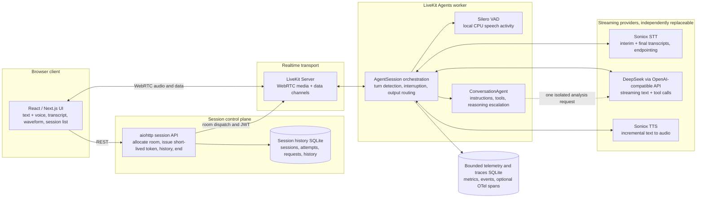

# OpenTalk

OpenTalk is a browser-based, realtime voice-assistant stack. It combines WebRTC transport, a native
LiveKit Agents session, independently replaceable streaming ASR / LLM / TTS providers, extensible agent
capabilities, and durable session history. The repository includes a text-only agent entry point,
a local microphone console, a minimal React/Next.js web client, versioned Docling PDF parsing,
Docker Compose packaging, and offline verification tools.

The generic conversation agent is the default runtime. New business capabilities can be added
through the agent factory without rewriting transport or session persistence.

---

## Demo Video
This video shows an earlier version of the demo.

https://www.youtube.com/watch?v=qIVQs0rmlEs

## 1. What OpenTalk is

- A streaming speech pipeline: microphone audio -> VAD/STT -> agent -> LLM/tools -> TTS -> browser
  playback, with interim text and cancellation.
- A reusable `ConversationAgent` with scoped reasoning escalation and guarded tool execution.
- Provider factories for Soniox streaming STT, OpenAI-compatible streaming Chat Completions, and
  Soniox streaming TTS. Each provider is configured independently and returns a native LiveKit
  plugin instance.
- A local CPU Silero VAD used for speech activity, endpointing support, and barge-in.
- Independent SQLite stores for resumable session history and bounded telemetry / traces.
- A minimal Next.js client that connects directly to LiveKit, supports text and voice modes, shows
  transcripts and a waveform, and talks to a same-origin session-control API.
- Local and Docker startup paths, component-level smoke tools, offline tests, and optional live
  integration tests.

The rest of this document describes the task, architecture, design choices, incremental development
path, implementation lessons, future work, and how to configure and run the project.

---

## 2. Talkbot task: functional and non-functional requirements

A talkbot is not just speech recognition followed by a chat response. It must maintain a realtime
conversation, decide when the user has finished speaking, orchestrate tools, stream text and audio
concurrently, react to interruptions, and persist enough state for a coherent multi-turn experience.

### 2.1 Functional requirements

| Area | Requirement |
| --- | --- |
| Conversation | Natural multi-turn voice or text interaction, with concise spoken-style answers. |
| Streaming | ASR, LLM output, and TTS audio stream independently; playback can start before the full answer is generated. |
| Turn handling | Detect start/end of user speech and avoid sending partial ASR hypotheses to the LLM. |
| Interruption | A user can barge in while the assistant is speaking; the obsolete response and queued audio stop, but already committed business work remains consistent. |
| Multilingual input | Preserve Chinese/English and code-switched content within an utterance and across turns. |
| Language preference | Track an optional `preferred_response_language` and apply it to later assistant output/TTS where supported. |
| Tools | Allow the model to inspect data and perform constrained business actions with structured arguments when new capabilities are registered. |
| Persistence | Keep resumable conversation history and user data separate from bounded diagnostics and business records. |
| Traces | Record model/tool/session events and optional OpenTelemetry spans for debugging and latency analysis. |
| Frontend | Minimal browser UI for text chat, voice capture, playback, transcript, connection state, and session selection. |

### 2.2 Non-functional requirements

| Area | Requirement and current design response |
| --- | --- |
| Latency | Use streaming plugins, disable speculative pre-generation, keep a fast default model profile, and allow TTS to start as soon as text is available. |
| Interruption responsiveness | Keep the microphone open during playback; use Silero VAD plus LiveKit's native interruption handling rather than an app-level "stop audio" hack. |
| Reliability | Use explicit session attempts, heartbeats, leases, stale-response checks, transactional writes, and idempotent request keys. |
| Observability | Record native model metrics, tool outcomes, usage, and optional OTel spans without unbounded logging of private audio or full prompts. |
| Replacability | ASR, LLM, and TTS are selected by configuration and wrapped in small factories. Business logic does not import voice or model SDKs. |
| Portability | Run as a text agent, local Python services, or a Docker Compose stack. The browser only receives short-lived room tokens. |
| Resource bounds | Bounded conversation context, bounded diagnostic queues, telemetry retention, and a maximum session duration. |
| Privacy | Provider credentials stay on the backend. The browser receives no model or LiveKit API secrets. |
| Maintainability | Small modules, native framework interfaces, offline component tests, and optional paid live tests. |
| Current scale | Optimised for a local, single-user deployment with SQLite and an in-process worker. Cloud concurrency and multi-tenancy are future work. |

---

## 3. Architecture, technology choices, and internal design

### 3.1 Architecture diagram



### 3.2 Core technology choices and why they were made

#### LiveKit as the realtime framework

LiveKit provides the room, WebRTC transport, media routing, data channel, participant lifecycle, and
native LiveKit Agents primitives. The Python `AgentSession` composes STT, LLM, TTS, VAD, turn
detection, output routing, tool execution, and interruption handling behind one session abstraction.
This avoids building a custom WebSocket audio protocol, jitter buffer, playback queue, and barge-in
state machine.

The browser stack is also native to LiveKit: `livekit-client` and `@livekit/components-react` can use
the same room model, participant audio, data messages, and RPC controls as the server. LiveKit Server
can dispatch a named agent into a newly allocated room, so the frontend does not need custom media
signalling.

#### Soniox for streaming STT and TTS

Soniox offers low-latency streaming speech-to-text and text-to-speech APIs with native LiveKit
plugins. The STT path returns interim and final segments, supports endpointing and language hints,
and can preserve mixed Chinese/English text. The TTS path accepts incremental text, buffers it at a
sentence-like boundary, and returns PCM audio while generation is still in progress.

Using one provider for STT and TTS also keeps credential and operational complexity low for the
reference deployment. The providers are not hard-wired: any LiveKit-compatible STT or TTS plugin
that satisfies the same streaming contract can be substituted. Multilingual quality, language
identification, code-switch handling, pronunciation, and latency are properties of the chosen
provider and model, not guarantees of the orchestration layer.

#### OpenAI-compatible DeepSeek for the LLM

The default LLM profile uses `deepseek-flash` at `https://api.deepseek.com` through an
OpenAI-compatible Chat Completions endpoint. DeepSeek is a practical low-latency default for
streaming text and tool calls, and the OpenAI-compatible interface keeps the application portable
across many providers. `config/llm.toml` controls base URL,
model, credential variable, temperature, token limit, timeout, and provider-specific `extra_body`
options.

The default profile disables thinking (`thinking.type = "disabled"`) so ordinary responses start
quickly. A separate reasoning profile can be enabled for an isolated stronger analysis request, as
described in the escalation section below. Any replacement model must support streaming and tool
calls; provider-specific options must be checked rather than assumed.

#### Silero VAD

Silero VAD runs locally on CPU through the LiveKit plugin. It is inexpensive, has no network round
trip, and is sufficient to detect speech start/stop and trigger interruption. LiveKit uses the VAD
signal together with STT endpointing: STT determines the text content and completed turn, while VAD
helps detect user speech while the assistant is speaking. This combination keeps interruption
latency low without sending extra audio to a dedicated service.

#### SQLite stores

Session history and bounded diagnostics use separate SQLite files. This gives the
reference deployment a zero-ops persistence model with transactions, stable IDs, and simple local
backups; the session and telemetry stores enable WAL. The separation is intentional:

- session history is needed for resume and prompt context;
- telemetry/traces are bounded diagnostics that can be dropped by retention policy.

SQLite is not the target for high-concurrency cloud deployment; the future-work section discusses
the changes that would be required for that environment.

#### React / Next.js frontend

The web client is a minimal Next.js application built on the LiveKit browser starter patterns. It
uses native LiveKit components and RPCs for text and voice modes, so it is naturally compatible with
the LiveKit Server and agent worker. Next.js route handlers proxy control-plane calls to the local
session API, which prevents the browser from speaking directly to an internal API and keeps server
secrets out of the client bundle.

### 3.3 Streaming ASR + LLM + TTS orchestration

The realtime path is designed around native LiveKit AgentSession nodes rather than several
application-managed queues:

1. The browser publishes microphone audio into a LiveKit room.
2. The agent worker subscribes to that audio and feeds it to the configured STT plugin. Audio also
   flows through Silero VAD in parallel.
3. Soniox STT emits interim hypotheses and final transcript segments. Interim text is used for live
   display, but the agent does not invoke the LLM for every partial hypothesis.
4. Turn detection is configured as `stt`: endpointing decides when the user has finished a turn.
   `preemptive_generation` is disabled, so there is no speculative generation from incomplete text.
5. The completed user turn enters the LLM node. `ConversationAgent.llm_node` trims the chat context,
   adds trusted runtime context (current UTC date/time), applies the preferred
   reply language, and then calls the native streaming LLM.
6. The LLM streams content chunks. If it emits a tool call, LiveKit executes the registered tool
   handler, appends the tool result to the model context, and continues the same agent turn up to the
   tool-step limit configured in `config/voice.toml`.
7. Assistant text chunks are emitted to the output path. The TTS node receives the same stream
   incrementally; the Soniox plugin buffers text at a sentence-like boundary and returns audio frames
   over its WebSocket while text generation is still running.
8. Audio frames are written into the LiveKit room and played by the browser. Text output is also
   available for the transcript and can be used without audio in text mode.

Because each stage is a streaming native node, first audio does not wait for the complete LLM answer.
The exact amount of overlap visible in a short utterance depends on model latency and text length; a
multi-sentence answer is the clearest way to observe audio-before-input-end behaviour.

### 3.4 Why this design supports barge-in natively

Barge-in is a first-class session event in this design:

- The user's microphone remains open while assistant audio is playing.
- Incoming speech is visible to both STT and Silero VAD.
- LiveKit is configured with interruption mode `vad`, a short `min_interruption_duration`, and
  `resume_false_interruption = false`.
- When sustained user speech is detected, the active `SpeechHandle` is marked interrupted. The
  framework cancels the current LLM generation and TTS stream, stops further text from being
  synthesized, and discards audio that has not yet been played.
- The new user speech is handled as a new turn. The interrupted response cannot keep appending to the
  new answer or revive a stale tool call.

The generic agent provides a guarded execution helper for future tools. Calls that become stale
before execution are rejected. Already-started work is shielded from speech cancellation;
new integrations must implement their own transactions, ownership checks, and idempotency.

In short, barge-in works because one realtime session owns the input audio, model streams, TTS output,
and playback queue. Stopping an obsolete answer is coordinated by the session, not by an out-of-band
application command.

### 3.5 Agent and capability composition

`ConversationAgent` owns language preferences, runtime context, stale-response validation,
reasoning escalation and guarded tool execution. `voice/factories.py` currently registers only
`conversation`. Add a service adapter and agent tools there when introducing a new business.
Session storage and browser controls remain independent of business implementations.

`escalate_reasoning(task, message?)` performs one isolated, tool-free analysis per user turn.
It returns the conclusion to the normal agent without changing the default model profile.

### 3.6 Session and trace persistence

OpenTalk deliberately separates two kinds of state:

| Store | Contents | Persistence style |
| --- | --- | --- |
| Session database | Sessions, attempts, idempotent allocation requests, native conversation history, userdata | Durable conversation state with resume semantics. |
| Telemetry / tracing database | Model metrics, session events, tool outcomes, usage, optional OTel spans | Bounded diagnostics with retention and event-count limits. |

The session store tracks a logical `session_id` and a per-run `attempt_id`. A session can be
`pending`, `active`, `completed`, or `failed`. Only normally `completed` sessions are resumable. A
resume creates a new attempt and a new room name while preserving the logical conversation ID.
Requests are idempotent, workers renew a heartbeat/lease, abandoned pending allocations expire, and
the maximum session duration is bounded.

Conversation history is serialised from LiveKit's native `ChatContext` using stable native item IDs.
Audio, images, metrics, and configuration updates are excluded. `SessionState` is stored as userdata
and currently contains `session_id`, `attempt_id`, and `preferred_response_language`. The journal
checkpoints after a conversation item is committed, with a short coalescing delay, and also on
heartbeat and normal shutdown. Restoring a session feeds the saved history back into a new agent
instance; old tool results provide context only and are not re-executed.

The session database has a small explicit schema: `sessions` stores the logical session, current
attempt, mode, room, status, and userdata; `attempts` stores per-run ownership, heartbeat, status,
and errors; `requests` makes allocation idempotent; and `history` stores serialised native
`ChatContext` items keyed by `(session_id, item_id)` with an ordering position.

The telemetry store uses a single bounded table,
`telemetry(event_id, session_id, attempt_id, kind, timestamp, payload_json)`, and upserts stable
IDs, so repeated checkpoints are safe. It contains model metrics, `response_started` /
`response_finished`, tool outcomes, errors, usage, and other bounded session events. Optional
tracing (`tracing_enabled` in `config/sessions.toml`) uses LiveKit's OpenTelemetry integration and a
SQLite span exporter. Content sharing is disabled for spans, and the resulting trace records
capture trace/span IDs, parentage, status, duration, and non-PII attributes. Tracing is disabled by
default.

Resumable history is not capped by diagnostics retention. Diagnostics can be trimmed or dropped
without affecting the user's conversation.

### 3.7 Web frontend

The frontend is a small Next.js and React application using the native LiveKit browser stack:

- `livekit-client` handles the WebRTC connection, microphone track, playback, data-channel
  messages, and RPC calls.
- `@livekit/components-react` provides session and agent hooks and audio visualisation components.
- The UI supports a text mode and a voice mode. Text uses LiveKit's native `lk.chat` stream; voice
  mode enables the microphone and uses a small RPC (`opentalk.set_voice_mode`) to switch output
  behaviour.
- Transcript messages follow native segment IDs, so interim revisions replace the same visible
  message instead of accumulating duplicates.
- A lightweight service panel checks the session API, LiveKit server, worker health, and provider
  configuration presence without calling paid provider APIs.
- Session selection, history, automatic save/close, and resume are handled through the control API.
- Next.js route handlers proxy control-plane requests to the internal session API, and the browser
  receives only a short-lived LiveKit JWT. Provider keys and LiveKit API secrets never reach the
  client bundle.

The minimal client connects to the same LiveKit Server,
AgentSession, and providers as the backend command-line paths.

### 3.8 Module internals worth knowing

```text
backend/opentalk/
  agents/base.py              Generic ConversationAgent: session hooks, language, stale checks,
                              reasoning escalation, tool execution guard.
  voice/session.py            Builds and runs the native AgentSession from configured providers,
                              VAD, histories, persistence, and interruption settings.
  voice/worker.py             LiveKit room worker and job/service lifecycle.
  voice/text.py               Text-only console with session commands.
  voice/room_control.py       Browser voice/text RPC and audio-mode controls.
  voice/factories.py          Agent composition boundary.
  asr/provider.py             Soniox STT factory and public config.
  llm/provider.py             OpenAI-compatible LLM factory and optional reasoning profile.
  tts/provider.py             Soniox TTS factory and public config.
  sessions/store.py           Sessions, attempts, requests, history, leases.
  sessions/tracing.py         Optional OpenTelemetry-to-SQLite exporter.
  sessions/telemetry.py       Bounded event/metric storage.
  sessions/api.py             Control API for allocation, tokens, history, and end requests.
  documents/parser.py         Docling PDF parsing and versioned file artifact export.
  documents/parse.py          Manual PDF parsing command-line entry point.
frontend/
  app/ and components/        LiveKit browser UI and server-side control proxy.
config/                       Public, non-secret configuration for providers and runtime.
tests/                        Offline backend tests plus opt-in live LLM tests.
```

The most useful design rule for future talkbot work is that each subsystem has one reason to change:
providers change when model services change, the agent changes when conversation policy or tools
change, the business service changes when domain rules change, and session storage changes only when
persistence semantics change.

---

## 4. Incremental development and testing

The project was built in independently testable stages. Each stage added one capability while
preserving the interfaces used by earlier stages.

### 4.1 LLM, ASR, and TTS developed and tested separately

The LLM provider was validated with a text streaming smoke tool. Soniox ASR was validated by
replaying a local media file through the real streaming protocol and observing interim/final events.
Soniox TTS was validated by feeding incremental text and writing the received PCM stream to a WAV
file. Offline tests used simulated WebSocket transports; live smoke tests remained opt-in and paid.
No frontend, room server, or agent was required for these component checks.

### 4.2 Native text agent

The text console uses the same native AgentSession and generic agent as the voice runtime.
Test-only tools exercise streaming tool protocols and cancellation without business data.

### 4.3 Session and trace management

The session store added durable logical sessions, run attempts, leases, resumable history, and
idempotent allocation. The telemetry side added bounded model/tool/session events and optional
OpenTelemetry spans. Text console commands were added for listing, inspecting, ending, and resuming
sessions.

### 4.4 Web frontend

The minimal Next.js client was adapted from the LiveKit browser starter. It added text/voice
switching, microphone capture, playback, transcript revision handling, session controls, a service
status panel, and a same-origin control proxy. It connects directly to LiveKit Server; no custom
media protocol was introduced.

### 4.5 Docker packaging

The full stack was packaged as separate API, worker, LiveKit, frontend services
with health checks, isolated named volumes, runtime-injected secrets, and an offline test profile.
The container entry points use the same Python modules and configuration as local development.

---

## 5. Challenges and design changes

### 5.1 Complex questions need more thinking without delaying the first response

Some requests need more analysis than a fast, non-thinking model should spend on the first pass.
Waiting for a long reasoning trace before saying anything would make the conversation feel
unresponsive, while always using a slow reasoning model would add latency to ordinary turns.

The current solution keeps the default profile fast and non-thinking, but gives the model an
`escalate_reasoning` tool. When the model judges that a question is difficult, it can:

1. emit a short acknowledgement immediately;
2. send a self-contained task and relevant facts to one isolated, stronger analysis request;
3. receive only the conclusion;
4. continue with the default profile and its registered tools.

Escalation is limited to once per user turn, and it does not mutate shared provider settings.

This is a pragmatic solution for this workload. If the default model were slower, a small, fast
router could be used to select model strength or reasoning level from question complexity. If a task
were extremely complex, long-running, or concurrent, a background sub-agent could be started through
a tool call and its result delivered later. Those remain tool-orchestration patterns rather than
changes to the transport architecture.

### 5.2 Written-style LLM output is often bad for TTS

By default an LLM may answer with Markdown tables, bullet lists, emoji, code blocks, headings, or
long written paragraphs. Those formats are poor or invalid input for many TTS systems.

The current system prompt explicitly requires short, natural, spoken-style sentences and forbids
tables, emoji, Markdown formatting, code blocks, and visual bullet lists in user-facing replies. Structured
arguments remain inside tool calls, not in spoken text. Where a prompt is not enough,
a streaming speech normaliser can transform model output into TTS-friendly text while preserving the
conversation stream.

---

## 6. Future work

### 6.1 Tone and paralinguistic understanding

The current pipeline treats speech as transcribed text. Tone, emotion, hesitation, emphasis, and
other non-textual cues are not part of the agent's decision context. Future work could add an audio
understanding tool or replace the ASR + LLM + TTS chain with a speech-to-speech multimodal model
when such a model provides the required control, latency, and tool-calling behaviour.

### 6.2 MCP for business integrations

Adding a new service currently requires a manual adapter and tool description. Supporting the Model Context Protocol (MCP) would allow
the agent to discover and call a broader ecosystem of existing tools and services. Future services can be exposed through MCP with additional authentication, capability filtering, and
auditing.

### 6.3 Background memory and retrieval

The current session design is voice-plus-text-oriented: history is stored and replayed as a
conversation context. In a native voice application, users should not have to manage session
history explicitly; memory should be created, summarised, retrieved, updated, and forgotten in the
background. Future work includes long-term memory extraction, semantic or hybrid retrieval,
user-profile management, privacy controls, and context assembly that hides the machinery from the
user.

### 6.4 Cloud deployment and concurrency

The current implementation is designed for local, effectively single-user use. A cloud service with
high traffic would need substantially more infrastructure:

- multiple distributed worker processes and autoscaling for LiveKit Agents;
- a shared session/state store such as PostgreSQL instead of local SQLite;
- a fast coordination/cache layer for leases, active-room routing, and rate limits;
- object storage for long transcripts, recordings, traces, and large artifacts;
- multi-tenant authentication, authorisation, quotas, and data-isolation controls;
- provider rate-limit handling, retries, fallback providers, and observability at fleet scale;
- highly available LiveKit and media network design rather than a local development server;
- secret management, audit, privacy/compliance controls, and CI/CD;
- load and soak testing for ASR/TTS concurrency rather than per-session correctness tests alone.

---

## 7. Configuration and startup

### 7.1 Requirements

| Component | Requirement |
| --- | --- |
| Python | Python 3.11 and `uv`; use `uv.lock` and `uv sync --locked --python 3.11`. |
| Frontend | Node.js 24 and pnpm 10.13.1; use `frontend/pnpm-lock.yaml`. |
| LiveKit | A local `livekit-server` binary or the Docker Compose service. The local config uses `devkey` / `secret`. |
| Provider credentials | `DEEPSEEK_API_KEY` for the LLM and `SONIOX_API_KEY` for ASR/TTS. Both are read from the process environment or `.env.local`; process environment variables take precedence. |
| Browser | A modern browser with microphone permission for voice mode. PortAudio and local audio devices are not required for the browser or Docker paths. |
| Docker | Docker Compose v2 for the container stack. On Windows, enable WSL integration for the project distribution. |

### 7.2 Environment file

Copy the placeholder example and fill in the provider credentials:

```bash
cp .env.example .env.local
```

The relevant variables are:

```dotenv
DEEPSEEK_API_KEY=...
SONIOX_API_KEY=...
LIVEKIT_URL=ws://localhost:7880
LIVEKIT_PUBLIC_URL=ws://localhost:7880
LIVEKIT_API_KEY=devkey
LIVEKIT_API_SECRET=secret
```

`LIVEKIT_URL` is the server URL used by Python services. `LIVEKIT_PUBLIC_URL` is the URL sent to the
browser. They can differ for remote or container deployments. Never put provider credentials or
LiveKit API secrets in `NEXT_PUBLIC_*` variables or the frontend environment.

### 7.3 Configuration map

| File | Purpose |
| --- | --- |
| `config/llm.toml` | LLM base URL, model, credential variable, default non-thinking options, and optional reasoning profile. |
| `config/asr.toml` | Soniox STT endpoint, model, language hints, sample rate, endpoint delay, and replay settings. |
| `config/tts.toml` | Soniox TTS endpoint, model, voice, primary language, sample rate, and timing settings. |
| `config/voice.toml` | LiveKit URL, agent name, VAD parameters, endpointing, and interruption duration. |
| `config/sessions.toml` | Session/telemetry database paths, heartbeat/lease limits, context size, API host/port, token TTL, and tracing switch. |
| `config/documents.toml` | Global PDF storage, parsing limits, image export, table mode, and Docling enrichment switches. |
| `config/livekit-local.yaml` | Local LiveKit development server configuration for same-machine browser testing. |
| `config/docker/` | Container-specific overrides for backend and session paths. |

Relative database paths are resolved from the project root, independently of the process working
directory.

### 7.4 Parse a PDF for inspection

PDF parsing is currently an independent backend command. It stores the original PDF globally by
content hash and writes every parse into a separate immutable version directory. It does not create
embeddings or expose retrieval to the conversation agent yet.

Install the optional parser dependency group without removing unrelated packages from an existing
environment:

```bash
uv sync --locked --inexact --group documents
```

Parse one local PDF:

```bash
PYTHONPATH=backend uv run --locked --group documents \
  python -m opentalk.documents.parse /path/to/document.pdf
```

The command prints the document ID, parse version and artifact paths. The default output root is
`data/documents`. Each parse contains `manifest.json`, lossless Docling JSON, readable Markdown, an
`elements.jsonl` structure/provenance view, referenced images, visual crops, and HTML/CSV table
exports. Picture descriptions, picture classification, formula recognition, code enrichment, OCR,
and accurate table extraction are enabled by default. These use local Docling models; the first run
may download model artifacts. Remote model services are disabled.

The optional Compose tool uses bind-mounted input and output directories:

```bash
OPENTALK_DOCUMENT_INPUT_DIR=/path/to/pdfs \
OPENTALK_DOCUMENTS_DIR=/path/to/document-data \
docker compose --profile documents run --build --rm document-parser /input/document.pdf
```

The input directory is read-only. PDF originals and every parse version are written beneath the
host output directory. A separate named volume caches downloaded Docling model artifacts.

### 7.5 Start the full local stack

Prepare the Python and frontend dependencies once:

```bash
uv sync --locked --python 3.11
cd frontend
pnpm install --frozen-lockfile
cd ..
```

Then start the services in separate terminals from the project root:

```bash
# Terminal 1: LiveKit transport
livekit-server --config config/livekit-local.yaml

# Terminal 2: session control API and token issuance
PYTHONPATH=backend uv run --locked python -m opentalk.sessions.api

# Terminal 3: LiveKit agent worker
PYTHONPATH=backend uv run --locked python -m opentalk.voice.worker dev --no-reload --log-level info

# Terminal 4: browser client
cd frontend
pnpm dev
```

Open <http://localhost:3000> and allow microphone access. The service panel should report the session
API, LiveKit server, worker, and provider configuration as available/configured. Default ports are
LiveKit `7880`, RTC TCP `7881`, RTC UDP `7882`, session API `8080`, worker health `8081`, and frontend
`3000`.

For a production-style frontend build use `pnpm build && pnpm start` instead of `pnpm dev`.

### 7.6 Docker Compose

Configure `.env.local`, then run from the project root:

```bash
docker compose up -d --build --wait
docker compose ps
docker compose logs --tail 100 worker api
```

Open <http://localhost:3000>. The stack includes LiveKit Server, the session API, the agent worker,
the standalone Next.js frontend. Session and telemetry data use separate named volumes.

```bash
# Stop the stack while preserving data.
docker compose down

# Run the backend offline test suite in isolation.
docker compose --profile test run --build --rm --no-deps backend-tests

```

See the Docker guide in `docs/` for port overrides, persistence and
media-path verification.

### 7.7 Text-only agent

The text console does not require LiveKit, ASR, TTS, a microphone, or PortAudio. It uses the same
agent and tool lifecycle:

```bash
PYTHONPATH=backend uv run --locked python -m opentalk.voice.text
PYTHONPATH=backend uv run --locked python -m opentalk.voice.text --agent conversation
```

It supports session commands such as `/session`, `/session list`, `/session history`, `/session
resume`, `/session end`, and `/quit`. A model credential is required once a normal message or a
session resume starts the agent.

### 7.8 Component smoke tests and tests

All commands below run from the project root. The smoke tests call paid provider APIs; the offline
test suite does not.

```bash
# Streaming LLM smoke test.
PYTHONPATH=backend uv run --locked python -m opentalk.llm.smoke

# Streaming ASR file replay; replace the WAV with your own recording.
PYTHONPATH=backend uv run --locked python -m opentalk.asr.replay recordings/demo.wav \
  --output logs/asr-demo.json

# Streaming TTS smoke test.
PYTHONPATH=backend uv run --locked python -m opentalk.tts.smoke \
  --text "你好，欢迎使用 OpenTalk。How can I help you today?" \
  --output recordings/tts-demo.wav --report logs/tts-demo.json

# Offline backend suite.
PYTHONPATH=backend uv run --locked pytest -q

# Explicitly opt into the live LLM test.
PYTHONPATH=backend uv run --locked pytest tests/test_llm_live.py --live-llm -q
```

### 7.9 More documentation

The README is the high-level guide. The `docs/` directory contains detailed validation guides,
including independent ASR, TTS, session, realtime voice, web, Docker, test procedures.
Some of those guides are written in Chinese. They remain useful for reproducing component-level
checks and should be consulted when changing providers, database schema, or deployment topology.

Useful starting points:

- [Testing and validation](docs/测试与验收.md) preserves component commands,
  previously kept in the README.
- [System design](docs/系统设计.md) defines architecture and module interfaces.
- The validation specification covers ASR, TTS, sessions, realtime voice, the browser client,
  Docker, and browser test cases.
