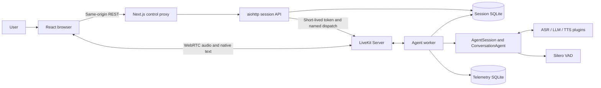

# System Design and Interface Contracts

## 1. Design scope and technology choices

The interface tables describe the current implementation. New interfaces follow root `AGENTS.MD`; proposals are not written as implemented contracts. PDFs use Docling, dense embeddings use FastEmbed, and Qdrant provides vector persistence and dense/lexical fusion.

| Choice | Current purpose and rationale | Cost and boundary |
| --- | --- | --- |
| Python 3.11, uv / `uv.lock` | Backend, native LiveKit SDK, and asynchronous lifecycle with reproducible locking. | Supported range is >=3.11,<3.12; a `pyproject.toml` declaration does not prove the installed version. |
| Node.js 24, pnpm 10.13.1, Next.js 15, React 19, TypeScript | Browser interaction and same-origin control proxy using native clients. | Frontend/backend lock independently; Next.js does not orchestrate audio. |
| LiveKit Server, Agents, and browser SDK | One native lifecycle for WebRTC, rooms, turns, tools, streaming audio, and interruption. | Depends on SDK contracts and ICE networking. C4 “containers” mean process boundaries, not only Docker containers. |
| Soniox ASR/TTS and Silero CPU VAD | Native plugins; ASR endpoints turns and VAD detects barge-in. | Remote audio services cost money. The voice factory currently fixes the vendor; adapters are replaceable but not arbitrary configuration switches. |
| OpenAI-compatible Chat Completions | Currently configured for DeepSeek; provides streaming text and tool calls. | Parameters and thinking-history rules vary by provider. Thinking is disabled by default; escalation is a separate tool-free request. |
| aiohttp | Session control API using an existing dependency. | No authentication layer; it cannot be exposed directly as a multi-user service. |
| Two SQLite/WAL databases | Separate resumable sessions from bounded diagnostics while keeping transactions/deployment simple. | Local shared files with no cross-database atomicity, distributed coordination, or tenant isolation. |
| Docker Compose | Local process group, health dependencies, persistent volumes, and isolated acceptance. | Development credentials, loopback media, and single-host configuration are not a public deployment. |
| Docling 2.138 with CUDA-capable PyTorch | Local structure-aware PDF conversion, enrichment, and inline picture-description VLM. One accelerator policy and bounded threaded pipeline apply across supported stages. | CUDA is the default parser device and requires a compatible host driver or Docker GPU runtime. Batch sizes trade throughput for GPU memory; CPU requires explicit configuration. |
| FastEmbed 0.9 / multilingual MPNet | Local Chinese/English dense embedding without PyTorch or a remote API. | Default model is about 1 GB with a 512-token limit; first use downloads it, and CPU latency/quality require corpus evaluation. |
| Qdrant 1.19 | Global named dense/sparse vectors and hierarchical/provenance payloads with local persistence and filters. | Current single-node unauthenticated setup; hybrid quality, quantization, capacity, and backup are not accepted yet. |

Do not invent performance advantages for existing choices. Propose the smallest alternative only when a requirement or evidence shows a limitation, and compare compatibility, cost, recovery, and testing impact.

## 2. Processes and layers

Python paths below are relative to `backend/opentalk/`; frontend paths are relative to `frontend/`.



The API returns a token to the browser; room configuration in the token and LiveKit perform dispatch. The API never proxies audio.

| Layer | Entry points | Responsibility and dependency boundary |
| --- | --- | --- |
| Presentation/browser transport | `frontend/components`, `lib`, `hooks` | Input, permission, transcripts, playback, and selected session; no SQLite access or provider secrets. |
| Control/service proxy | `frontend/app/api/control`, `sessions/api.py` | Validate and proxy control requests, allocate sessions/tokens, and query state; no generation queue. |
| Realtime lifecycle | `voice/session.py`, `worker.py`, `room_control.py` | Compose native sessions, I/O, RPC, cleanup, heartbeat, and resume; no business rules. |
| Agent policy | `agents/base.py`, `voice/factories.py` | Spoken style, language preference, trusted runtime context, stale-response guards, retrieval, and reasoning; the factory is the composition boundary. |
| Model adapters | `asr/provider.py`, `llm/provider.py`, `tts/provider.py` | Create native plugins, load configuration/credentials, and translate vendor options; no history database access. |
| State/storage/observability | `sessions/store.py`, `state.py`, `telemetry.py`, `tracing.py`, `voice/journal.py` | Durable history, attempt leases, bounded events, and checkpoints; independent of business implementations. |
| Global document parsing | `documents/config.py`, `parser.py`, `parse.py` | Validate local PDFs, run Docling, and save source/versioned artifacts; independent of sessions, agents, and vectors. |
| Document management/pipeline | `documents/library.py`, `pipeline.py`, `process.py`, `sessions/api.py`, `components/document-panel.tsx` | Stream uploads, list manifest state, and compose parse/index/vector stages in a terminable subprocess; never writes session data. |
| Index preparation | `documents/indexing.py`, `index_inspection.py` | Produce and inspect database-independent hierarchical nodes; no embedding or storage SDK. |
| Retrieval | `documents/lexical.py`, `retrieval.py`, `retrieve.py` | Create deterministic sparse vectors, fuse dense/lexical results, and expand parents/neighbors; no LiveKit or session storage. |
| Embedding/vector storage | `documents/embedding.py`, `vector_index.py`, `vector_store.py` | Enforce token limits, embed text, build payloads, and idempotently write Qdrant; no LiveKit, agent, or session dependency. |
| Business extension | `voice/factories.py` extension point | No current implementation. New services own their data, authorization, and idempotency and do not depend on the browser. |

The API and worker must use the same session database and compatible configuration. A business service must not import LiveKit or model SDKs; framework adaptation belongs in the agent/factory layer.

## 3. Core flows and invariants

1. **Create:** `reserve` creates a pending session/attempt. The API issues a token for a new room. The worker verifies metadata/room and becomes the sole owner through `claim` before starting.
2. **Respond:** interim speech is display-only. An STT endpoint completes a turn, then the LLM streams into text/TTS output. Long TTS input rotates through bounded provider requests without ending the LiveKit response; response completion still waits for audio playout. The system does not speculate on every partial transcript.
3. **Mode:** browser text uses `lk.chat`; `opentalk.set_voice_mode` controls audio input/output. Text bypasses playback synchronization. Disabling voice stops TTS while the original LLM text stream continues.
4. **Interrupt:** VAD triggers native speech interruption. Tools validate turn/speech before starting; guarded work already underway is allowed to finish. The guard is not a transaction, authorization check, or business rollback.
5. **Save:** committed native messages trigger coalesced checkpoints, with heartbeat and shutdown as fallbacks. Only successful final persistence and provider closure publish `completed`.
6. **Resume:** `completed → pending new attempt → active`, retaining the session ID while creating a new room and restoring bounded `ChatContext`/userdata without replaying tools.

Session state is `pending → active → completed/failed`. A pending attempt can fail when ended before start or expired. Completed sessions can create a new attempt; failed sessions cannot resume. Lease expiry is checked during query/allocation operations rather than by a dedicated realtime sweeper.

## 4. External control interfaces

Backend paths begin at `/...`; browser paths begin at `/api/control/...`, and the proxy exposes only an allowlist. `GET /health` is backend-only. Session records use snake_case; SDK connection objects retain camelCase. Do not rename them without migration.

| Method/path | Input | Successful result |
| --- | --- | --- |
| `GET /health` | None | 200 `{status:"ok"}`; verifies session-store access. |
| `GET /health/services` | None | 200 `{status:"ok"|"degraded",services:{...}}`. |
| `POST /sessions` | Required `request_id`; default agent `conversation`; optional `resume_session_id`; default `voice_enabled=true`. | 200 Allocation. A new allocation is pending; a returned token does not prove media connection. |
| `GET /sessions` | `limit` default 20, 1..100; `offset` default 0, non-negative. | 200 Session array ordered by descending `updated_at`. |
| `GET /sessions/{id}` | Session ID. | 200 `{session,attempts}`. |
| `GET /sessions/{id}/history` | `limit` default 100, 1..1000; `offset` default 0. | 200 `{items:[...]}`, native history in stored position order. |
| `GET /sessions/{id}/history?tail=true` | `limit` default 200, 1..1000. | 200 latest items in forward order; offset ignored. |
| `POST /sessions/{id}/end` | `{attempt_id:string}`. | 202 while active, 200 when terminal, body is Session. Ending pending becomes `failed/not_started`. |
| `DELETE /sessions/{id}` | Session ID. | 200 `{deleted:true,session_id}`; terminal only, deleting history, attempts, request records, and telemetry. |
| `GET /documents` | None. | 200 `{items,max_file_size_bytes}` with global documents and three-stage state. |
| `POST /documents` | One multipart PDF. | 202 for new work; 200 for reused ready content; returns `accepted`, `job_id`, and document. |
| `DELETE /documents/{id}` | 64-character lowercase hexadecimal ID. | 200 `{deleted:true,document_id}`; deletes Qdrant points before the file directory. |

`request_id` is a non-empty string of 1..200 characters. Allocation contains `session, serverUrl, roomName, participantName, participantToken`. Common Session fields are `session_id, attempt_id, agent_key, mode, status, room_name, userdata, created_at, updated_at, ended_at, end_requested, error_code`. Time fields are Unix seconds. Userdata contains session ID, attempt ID, and optional `preferred_response_language`.

```json
{"request_id":"client-generated-id","voice_enabled":false}
```

Resume uses a new request ID plus `resume_session_id`; end includes the current attempt ID. The browser cannot choose an arbitrary agent: new sessions use proxy `OPENTALK_AGENT`, while resume uses the saved agent key.

| Error | Current response semantics |
| --- | --- |
| `invalid_request` | 400: invalid request shape, field, or agent. |
| `session_not_found` | 404. |
| `not_resumable`, `agent_mismatch`, `stale_attempt`, `stale_request`, `idempotency_conflict`, `session_closed`, and other `SessionError` values | 409; `invalid_page` currently also uses this path. |
| `missing_credentials` | 503: LiveKit server credentials missing. |
| `room_cleanup_failed` | 502 with the completed/failed session; persistence was not rolled back. |
| `session_busy`, `document_busy` | 409: end the active session or wait for document processing. |
| Document errors | `document_not_found` 404; `invalid_document_id` 400; delete/unavailable failures 503. |
| Proxy errors | Unknown path 404, cross-origin POST 403, oversized body 413, malformed input 400, backend unavailable 503. |

Generic backend errors usually use `{error,message}`; some proxy errors use only `{message}`; a successful end body is not wrapped in `session`. These are current contract differences, not a unified format. See G-05 for missing invalid-input and storage-failure mappings.

**Idempotency boundary:** allocation currently binds request ID to `(mode, agent_key, resume_id)`. A key from an old attempt cannot resume. `voice_enabled` is not part of the persisted comparison (G-04). A repeated allocation may issue another token; the stable objects are session/attempt, not JWT bytes.

## 5. Realtime and internal interfaces

| Interface | Input → output | Required semantics |
| --- | --- | --- |
| `lk.chat` | User text → native AgentSession input. | Do not add a parallel custom WebSocket chat protocol. |
| RPC `opentalk.set_voice_mode` | `{enabled:boolean}` → same JSON. | Caller identity must match the user; invalid 1400, unauthorized 1403, not ready 1503. Set mode before first text. |
| `agent_factory(agent_key="conversation")` | Key → async factory. | Unknown key raises `ValueError`; factory receives journal/state/chat context/limits/reasoning and returns an Agent. |
| `open_session(...)` | Configuration, allocation/resume, factory, injectable models → async context manager. | Yields `(session,agent,journal)`; caller starts the session; exit closes resources and performs the final checkpoint. |
| `create_stt/create_llm/create_tts` | Configuration, optional ASR/TTS HTTP session → native plugins. | Invalid configuration or missing credentials raises `ValueError`; upper context manager owns resources. TTS request input is bounded before it reaches the provider so a long answer can continue across requests. |
| `execute(context,name,action)` | Native `RunContext` and awaitable action → dictionary. | Action returns identifiable success/error; stale turns return `stale_response`; started work is shielded; there is no default business idempotency. |
| `escalate_reasoning(task,message)` | Self-contained task and model-generated notice → `{ok,analysis}` or error. | Main model generates a relevant short notice; application validates length/language and speaks it unchanged. Main and reasoning models share the turn-language constraint. Tool-free and once per turn; stable failures include `reasoning_unavailable`, `already_escalated`, `stale_response`, `invalid_notice`, `notice_language_mismatch`, and `empty_analysis`. |
| `SessionStore.reserve/claim/heartbeat/checkpoint/request_end/delete` | IDs, owner, history/userdata → saved state or error. | Synchronous SQLite runs through `to_thread`; checkpoint verifies owner/lease; history and terminal state share a transaction; delete is terminal-only. |
| `SessionJournal.record/save`, `TelemetryStore.write` | Stable events/native history → checkpoint/event upsert. | Record does not wait for I/O. Telemetry and history writes are separate database operations with no cross-database transaction. |

New business interfaces specify parameter/result types, errors, timeout, cancellation, authorization, idempotency key, and resource owner. No new framework abstraction is required now.

## 6. Data and configuration

| Data | Ownership and deduplication | Lifecycle |
| --- | --- | --- |
| sessions/attempts/requests | `SessionStore`; logical session, runtime owner, stable allocation request. | One-database transactions; terminal sessions can be deleted explicitly. No schema migration or automatic retention. |
| history | `(session_id,item_id)` upsert with ordered positions; native `ChatContext`. | Stores conversation/tool exchanges, excluding audio/images/metrics/config events. Resume uses a bounded tail. |
| userdata | `SessionState` dataclass → JSON. | Language preference follows the logical session; attempt ID changes per run. |
| telemetry | `event_id` upsert; metrics, usage, errors, optional spans. | At most 10,000 rows / 7 days; session deletion removes matching telemetry; queue default 512. Tracing off does not make archives insensitive. |
| Browser localStorage | Selected session/attempt and close intent. | No message body, token, or key. Backend state governs resume. |
| Component reports/recordings | ASR/TTS CLI JSON and WAV. | Atomic report replacement; failed TTS does not overwrite successful audio; cancellation may write `partial.wav`; never commit them. |
| PDF sources/artifacts | Global `data/documents/<content-hash>/`. | `source.pdf`; immutable `parses/<version>/`; explicit deletion removes the entire content directory. Session-independent. |
| Document vectors/payloads | Global Qdrant collection with stable UUID point IDs. | One collection per embedding profile; reruns upsert; explicit document deletion filters by ID. Session-independent. |

Public configuration lives in `config/`. Credentials come from process environment or root `.env.local`, with existing environment values winning. Paths resolve from the project root. `OPENTALK_SESSION_CONFIG` or explicit arguments can select session configuration.

Defaults are heartbeat 5 s, lease 60 s, token/pending deadline 900 s, maximum session 3600 s, context 120 items, and 8 tool steps. These are engineering settings, not SLOs. Local databases are `data/sessions.sqlite3` and `logs/telemetry.sqlite3`; Docker uses `session-data` and `telemetry-data`.

Default ports: frontend 3000, LiveKit 7880 / RTC TCP 7881 / UDP 7882, API 8080, worker health 8081. Internal `LIVEKIT_URL` may differ from browser `LIVEKIT_PUBLIC_URL`. Public deployment also requires authentication, TLS, media routing, and operational guarantees; see the backlog and validation guide.

## 7. PDF parsing and RAG design

### 7.1 Module responsibilities

`opentalk.documents` contains independently testable parser, preparation, vectorization, retrieval, and file-access modules. The parser validates PDFs, manages global layout, invokes Docling, and exports artifacts. Preparation reads one completed parse and produces hierarchical nodes plus a compact structure catalog. Vector indexing uses an independent provider for dense vectors, creates sparse lexical vectors, and writes through a storage adapter. Retrieval runs dense/lexical RRF and expands parents or neighbors. File access browses outlines/sections/pages and performs exact or fuzzy text location without Qdrant. None imports LiveKit, Agent, or session storage.

`pipeline.process_pdf` composes parsing, preparation, and vectorization in data-flow order; the upload API invokes it in a controlled subprocess. `ConversationAgent.search_documents`, `inspect_document`, and `find_document_text` are the LiveKit tools at the composition boundary.

The default Docling standard pipeline enables OCR, accurate table structure, page/picture/table crops, picture classification/description, formula enrichment, code enrichment, and heading-level inference. `HeadingHierarchyOptions` uses bookmarks, numbering, then visual style; parsed pages remain available during conversion for the style signal. Remote model services are disabled. A shared `AcceleratorOptions` selects CUDA for supported models, including the inline picture-description VLM. The threaded PDF backend renders pages with configurable parser threads; Docling's standard pipeline overlaps OCR, layout, and table stages with separate page batches and a bounded queue, while picture descriptions have their own VLM batch size. Page images are retained by Docling until all picture/table crops are assembled, so image scale and queue depth are host-memory controls as well as throughput controls. Defaults use scale 1.0, four parser threads, four-page OCR/layout batches, two-page table batches, four-item picture-description batches, and eight-page queues after scale 2.0 plus deeper queues drove a 629-page parse beyond 20 GiB RSS. The application still schedules one document job at a time because job-level concurrency would duplicate model memory. The configured device, thread, batch, queue, and Flash Attention settings are copied to the immutable parse manifest. The default capacity is 1,000 pages, 500 MiB, and a two-hour Docling processing budget so large books are not cut off by the former ten-minute budget. A simple-PDF routing optimization is deferred until tests justify it.

The API samples its Linux cgroup `oom_kill` counter around each document subprocess. If the counter increases, or the process otherwise exits by a signal/nonzero status, the owner atomically changes the active parse, preparation, or vector manifest to `failed` and records the return code and bounded reason. This covers failures such as SIGKILL that Python code inside the child cannot catch and prevents a dead job from remaining permanently marked `parsing`.

The parser retains Docling's complete `ConversionResult` until validation. Only `success` with a positive source page count and the same number of processed pages can publish artifacts as completed. `partial_success`, timeout, and mismatched page counts produce a failed manifest containing Docling status, source/processed counts, error count, and bounded structured error details. This prevents a usable-looking prefix of a large PDF from entering indexing and retrieval.

### 7.2 Interfaces and data contracts

```bash
PYTHONPATH=backend uv run --locked --group documents \
  python -m opentalk.documents.parse INPUT.pdf [--config PATH] [--storage-root PATH]
```

Successful stdout JSON includes `document_id`, `parse_version`, `source_path`, `parse_path`, and `manifest_path`.

```text
data/documents/<document_id>/
  source.pdf
  parses/<parse_version>/
    manifest.json
    document.json
    document.md
    elements.jsonl
    assets/
    visuals/
    tables/
    indexing/<profile>/
      index_manifest.json
      nodes.jsonl
      structure.json
      vector_indexes/<embedding_profile>/
        manifest.json
```

`document_id` is SHA-256 over PDF bytes. `parse_version` includes Docling version, UTC time, and a random suffix. `document.json` preserves Docling structure; `elements.jsonl` is an inspectable projection for downstream modules. Fields include `element_id, type, label, level, heading_level, content_layer, parent_id, child_ids, text, provenance, visual_path, table_outputs, metadata, annotations`. Traversal depth and semantic heading level remain separate, and content layer preserves Docling's body/furniture decision. Pictures use referenced files. Tables also export HTML/CSV, and formulas/pictures/tables save PNG crops where possible.

Preparation follows `elements.jsonl` order and supplements heading semantics from `document.json` for older parse projections. Headings recognized inside pictures or tables do not change section boundaries. Hierarchy is `document → nested section → context → chunk/non-text`; long tables add `table → table_chunk`. Chunks and described non-text leaves are indexable; sections and bounded contexts exist only for expansion. Every retrievable node stores previous/next IDs for fallback. The `hierarchical-v3` structure catalog stores stable section IDs, parent/child links, heading pages, direct/subtree page ranges, ordered direct node IDs, and page-to-node references without duplicating body text.

Character limits come from `config/documents.toml [indexing]`. Character splitting stays tokenizer-independent for stage inspection; vectorization separately enforces the selected model tokenizer. Nodes retain element IDs, pages, coordinate provenance, section path, and asset references. A table parent stores complete content and bounded retrievable children. An undescribed picture retains an asset node without placeholder semantic text.

Picture retrieval text uses a whitelist: caption, description, summary, keywords, topics, entities, enriched code/molecule content, and chart title. `created_by`, provenance, classification candidates, confidence, annotation kind, and generation control tokens are processing metadata only. Preparation excludes only explicit `content_layer=furniture`, `page_header`, or `page_footer` elements and their structural descendants. It never infers furniture from position, repetition, hashes, or classification; missed headers/footers remain body text.

Vectorization reads only non-empty `indexable=true` nodes. Stable point IDs derive from document, parse, index profile, embedding profile, and node ID. Payloads include leaf text, embedding/sparse text, parent snapshot, neighbor IDs, section metadata, pages, coordinates, element IDs, and asset references. The vector manifest records model, dimension, vector names, collection, and count without duplicating vector values into files. FastEmbed counts tokens before model calls and fails oversized input so preparation can produce smaller chunks.

Lexical encoding normalizes NFKC and case. Chinese spans produce characters and bigrams; other Unicode alphanumeric spans produce tokens. Stable hashing maps terms into sparse dimensions, term frequency uses logarithmic scaling, and Qdrant applies collection IDF. The service produces dense/lexical queries for the original and at most one alternate wording and combines rankings with RRF.

Results preserve the precise matched leaf. A valid parent becomes reasoning context; otherwise retrieval fetches previous/next retrievable nodes. Results include document/parse version, node type, section, pages, provenance, and assets. Image paths must resolve to existing files below the matching parse directory. The agent reads bounded image counts/sizes only when explicitly requested and adds them as temporary `ImageContent`; the session archive retains normal messages and textual tool results only.

Structured access resolves the latest completed requested profile and caches at most four immutable document indexes per process. Outline calls return only one parent level. Section and page calls enforce page-span, item, and total-character limits and expose a continuation cursor, including an intra-node character offset for large tables or chunks. Page lookup uses stored integer page metadata rather than searching page-number text.

Text location searches section titles and canonical direct content nodes. It tries raw substring and NFKC/case/whitespace-normalized substring matches first. `auto` invokes RapidFuzz local alignment only when no exact match exists; explicit `fuzzy` always permits approximate candidates. Exact classes, alignment score, title preference, stable document order, overlap deduplication, and a per-section cap determine ranking. Hybrid retrieval remains available for conceptual, paraphrased, and cross-language questions.

### 7.3 Technology details

Docling is pinned in the optional `documents` dependency group. FastEmbed, Qdrant client, and RapidFuzz are default runtime dependencies and part of `rag`, because the conversation agent embeds queries and can perform deterministic text location. Default embedding is `sentence-transformers/paraphrase-multilingual-mpnet-base-v2`, 512 tokens, collection `opentalk_documents_multilingual_mpnet_hybrid_v1`. Model/schema changes require a new profile or collection; the old dense-only collection is retained rather than migrated in place.

Qdrant is part of the default Compose stack with a `qdrant-data` volume. One-shot index commands still use the `rag` profile. Host directories mount document files, and model cache has a separate volume. `OPENTALK_QDRANT_URL` overrides the public local address. The worker mounts documents read-only and reuses the embedding cache.

Each LiveKit job process creates one retrieval service and one lightweight file-access service during prewarm, then starts a query embedding in a background thread. Process readiness and room connection do not wait for FastEmbed/ONNX initialization. A first semantic query arriving during warmup waits for the same initialization and cannot load a second model concurrently. Structure and text access do not load the embedding model or contact Qdrant. Warmup does not access the Qdrant collection; schema and embedding-space validation remain part of the first actual semantic search.

The frontend calls `GET /documents`, `POST /documents`, and `DELETE /documents/{id}` through the same-origin proxy. POST accepts one size-limited multipart file with a PDF signature, writes a temporary global file, and queues it immediately. One background slot prevents concurrent local Docling/embedding model loads; service shutdown terminates owned subprocesses. Listing reconstructs state from manifests and overlays current queued/processing state before manifests exist. A stale running manifest after restart does not permanently prevent deletion. Ready content is reused; failed re-upload can create a new parse. DELETE rejects queued/processing documents, then removes Qdrant points before files.

At startup the Docker API and worker read the numeric UID/GID of the shared document mount and run as that identity so both can write the session volume. The worker has read-only document access; API/document subprocesses have write access. Before dropping privileges, the entrypoint prepares separate HOME, XDG cache/config/data, session, and telemetry directories and validates permissions. Docling fonts, models, and temporary data must not fall back to root's HOME. The default Compose file grants GPUs to both the long-running API, which owns frontend-upload parsing subprocesses, and the one-shot document parser. `compose.cpu.yaml` removes those GPU requests and sets `OPENTALK_DOCUMENT_DEVICE=cpu`. Changing a Compose GPU request requires container recreation; a restart preserves the old device configuration.
