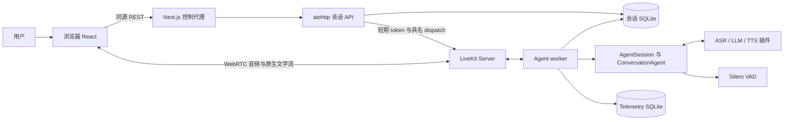

# 系统设计与接口契约

## 1. 设计范围与技术选择

本文件的接口表描述当前实现。新增接口遵守根目录 AGENTS.MD；改造建议不提前写成已实现契约。PDF 使用 Docling 解析，embedding 使用 FastEmbed，向量持久化使用 Qdrant；Retrieval 技术在对应模块实施时确定。

| 选择 | 当前用途与理由 | 代价／适用边界 |
| --- | --- | --- |
| Python 3.11、uv／uv.lock | 后端、原生 LiveKit SDK、异步生命周期；锁定复现 | Python 范围为 >=3.11,<3.12；pyproject.toml 声明不等于安装版本 |
| Node.js 24、pnpm 10.13.1、Next.js 15、React 19、TypeScript | 浏览器交互及同源控制代理；复用原生客户端 | 前后端分别锁定依赖；Next.js 不承载音频编排 |
| LiveKit Server／Agents／浏览器 SDK | WebRTC、房间、轮次、工具、流式音频和打断共用原生生命周期 | 依赖 SDK 契约和 ICE 网络；C4 的容器指进程边界，并不限 Docker 容器 |
| Soniox ASR／TTS、Silero CPU VAD | 使用原生插件；ASR 判轮次，VAD 检测插话 | 远端音频服务有费用；当前语音工厂固定供应商，适配可替换但非任意配置切换 |
| OpenAI 兼容 Chat Completions | 当前配置 DeepSeek；流式文字和工具调用 | 参数／thinking 历史规则因供应商不同；默认禁用 thinking，升级为独立无工具请求 |
| aiohttp | 会话控制 API，复用现有依赖 | 当前无认证层，不能直接暴露为多用户服务 |
| 两个 SQLite／WAL 数据库 | 会话恢复与有界诊断分开，事务与部署简单 | 本机共享文件；没有跨库原子性、分布式协调或多租户隔离 |
| Docker Compose | 本地进程组、健康依赖、持久化卷、隔离验收 | dev 凭据、回环媒体和单机配置，不是公网部署方案 |
| FastEmbed 0.9／多语言 MPNet | 在独立离线进程生成中英文 dense embedding；不要求 PyTorch 或远程 API | 默认模型约 1GB、512 token 上限；首次使用需下载，CPU 时延和召回质量仍需真实语料评估 |
| Qdrant 1.19 | 全局保存命名 dense vector 与层级／来源 payload；本地 Docker 可持久化和过滤 | 当前仅单机无认证配置；Hybrid、量化、容量和备份策略尚未验收 |

不为已有方案补写未经证实的性能优越性。只有明确需求或证据显示现方案不足，才提出最小替代方案并比较兼容、成本、恢复和测试影响。

## 2. 进程与分层

下表 Python 路径以 backend/opentalk/ 为根；前端路径以 frontend/ 为根。



token 由 API 返回给浏览器；实际调度由 token 的房间配置和 LiveKit 完成。API 不代理音频。

| 层 | 代码入口 | 职责与依赖边界 |
| --- | --- | --- |
| 展示／浏览器传输 | frontend/components、lib、hooks | 输入、权限、字幕、播放和选中会话；不读 SQLite、不持有 provider 密钥 |
| 控制／服务代理 | frontend/app/api/control、sessions/api.py | 校验控制请求，代理、分配会话和 token、查询状态；不管理生成队列 |
| 实时生命周期 | voice/session.py、worker.py、room_control.py | 组合原生会话，输入输出、RPC、资源关闭、心跳与恢复；不实现业务规则 |
| Agent 策略 | agents/base.py、voice/factories.py | 口语回复、语言偏好、受信运行上下文、过期校验及 reasoning 工具；factory 为业务组合边界 |
| 模型适配 | asr/provider.py、llm/provider.py、tts/provider.py | 创建原生插件、加载配置／凭据，转换供应商选项；不操作历史数据库 |
| 状态／存储／观测 | sessions/store.py、state.py、telemetry.py、tracing.py；voice/journal.py | durable history、attempt 租约、有界事件、checkpoint；不依赖业务实现 |
| 全局文档解析 | documents/config.py、parser.py、parse.py | 校验本地 PDF、运行 Docling、保存原件和按版本组织的中间文件；不依赖 session、Agent 或向量库 |
| 文档索引准备 | documents/indexing.py、index_inspection.py | 从解析产物形成数据库无关的层级节点并检查结构；不依赖 embedding provider 或存储 SDK |
| Embedding／向量存储 | documents/embedding.py、vector_index.py、vector_store.py | 校验模型 token 边界、生成 dense vector、构造检索 payload 并幂等写入 Qdrant；不依赖 LiveKit、Agent 或 session |
| 业务扩展 | voice/factories.py 接入点 | 当前无实现；新增服务自己管理业务数据、权限和幂等，不反向依赖浏览器 |

API 与 worker 必须使用同一会话库和一致配置。新业务服务不导入 LiveKit 或模型 SDK，框架适配放在 Agent／factory 层。

## 3. 关键流程与不变量

1. 创建：`reserve` 得到 pending session／attempt；API 签发新房间 token。worker 核对 metadata 与房间，`claim` 成为唯一 owner，再启动会话。
2. 回复：语音 interim 仅展示，STT endpoint 完成轮次后请求 LLM；流式内容进入文本／TTS 输出。不对每个临时字幕投机生成。
3. 模式：网页文字流使用 `lk.chat`；`opentalk.set_voice_mode` 控制音频输入输出。文字输出绕过播放同步；关闭语音停止 TTS，继续原 LLM 文本流。
4. 打断：VAD 触发原生 speech interruption。工具开始前校验 turn／speech；已经开始的 guarded action 等待完成。守卫不提供事务、授权或业务撤销。
5. 保存：原生消息提交触发合并 checkpoint，心跳和关闭兜底。只有最终保存及 provider 关闭成功才公布 completed。
6. 接续：completed → 新 pending attempt → active；同 session ID，新房间，恢复有界 ChatContext 和 userdata，不重放工具。

会话状态：`pending → active → completed/failed`；pending 可因未启动结束或过期进入 failed。completed 可创建新 attempt；failed 不可恢复。租约过期在查询／分配等调用时检查，不是独立的实时清理调度器。

## 4. 外部控制接口（现状）

后台为 `/...`，浏览器前缀为 `/api/control/...`；代理只暴露白名单路径。`GET /health` 仅后台提供。snake_case 用于会话记录，连接对象沿用 SDK 的 camelCase；不要未经迁移统一改名。

| 方法／路径 | 输入 | 成功结果 |
| --- | --- | --- |
| GET /health | 无 | 200，`{status: "ok"}`，检查会话库可访问 |
| GET /health/services | 无 | 200，`{status: "ok"或"degraded", services: {...}}` |
| POST /sessions | request_id 必填；agent 默认 conversation；resume_session_id 可选；voice_enabled 默认 true | 200，Allocation；新分配是 pending，不能把返回 token 视为媒体已连接 |
| GET /sessions | limit 默认20，1..100；offset 默认0，非负 | 200，Session 数组，updated_at 降序 |
| GET /sessions/{id} | session ID | 200，`{session, attempts}` |
| GET /sessions/{id}/history | limit 默认100，1..1000；offset 默认0 | 200，`{items: [...]}`，原生历史，按存储 position 升序 |
| GET /sessions/{id}/history?tail=true | limit 默认200，1..1000 | 200，最近若干项，仍按正序；忽略 offset |
| POST /sessions/{id}/end | `{attempt_id: string}` | 活动为202，终态为200，正文是 Session；pending 结束进入 failed/not_started |

request_id 是 1..200 字符的非空字符串。Allocation 包含 `session, serverUrl, roomName, participantName, participantToken`。Session 常用字段为 `session_id, attempt_id, agent_key, mode, status, room_name, userdata, created_at, updated_at, ended_at, end_requested, error_code`。时间字段为 Unix 秒；userdata 包含会话 ID、attempt ID 和可选 preferred_response_language。

创建示例：

```json
{"request_id":"client-generated-id","voice_enabled":false}
```

恢复使用新 request_id 加 `resume_session_id`；结束明确带当前 attempt_id。浏览器不能指定任意 Agent：新建由代理的 OPENTALK_AGENT 选择，恢复由保存的 agent_key 选择。

| 错误 | 当前响应语义 |
| --- | --- |
| invalid_request | 400：请求结构、字段或 Agent 无效 |
| session_not_found | 404 |
| not_resumable、agent_mismatch、stale_attempt、stale_request、idempotency_conflict、session_closed 等 SessionError | 409；当前 invalid_page 也经该路径返回409 |
| missing_credentials | 503，缺少 LiveKit 服务端凭据 |
| room_cleanup_failed | 502，包含已完成／失败的 session；不表示持久化已撤销 |
| 代理错误 | 未知路径404、外域 POST 403、过大正文413、格式400、后台不可达503 |

通用后台错误通常为 `{error, message}`，代理部分错误仅 `{message}`，end 的成功正文不嵌套 session。这是现有契约差异，不能宣称已统一。当前未覆盖所有异常输入与存储故障映射，见 G-05。

**幂等边界**：当前分配绑定 request_id 与 `(mode, agent_key, resume_id)`；旧 attempt 的键不可用于接续。voice_enabled 未纳入持久化幂等比较，见 G-04。重复分配可签发新 token，稳定的是会话／attempt，不是 JWT 字节内容。

## 5. 实时与内部接口（现状）

| 接口 | 输入 → 输出 | 必须保留的语义 |
| --- | --- | --- |
| `lk.chat` | 用户文字 → 原生 AgentSession 输入 | 不增加平行的自制 WebSocket 聊天协议 |
| RPC `opentalk.set_voice_mode` | `{enabled: boolean}` → 同形 JSON | caller_identity 必须为关联用户；非法输入1400，越权1403，尚未就绪1503；就绪后再发送首条文字 |
| `agent_factory(agent_key="conversation")` | key → async factory | 未知 key 抛 ValueError；factory 接收 journal、state、chat_ctx、context_max_items 和 reasoning 参数，返回 Agent |
| `open_session(...)` | 配置、分配／resume、factory、可注入模型 → async context manager | yield `(session, agent, journal)`；调用者执行 session.start；退出负责关闭和最终 checkpoint |
| `create_stt/create_llm/create_tts` | 配置，ASR／TTS 可注入 HTTP session → 原生插件 | 配置与缺凭据失败为 ValueError；资源由上层 context manager 关闭 |
| `execute(context, name, action)` | 原生 RunContext 与 awaitable action → dict | action 返回至少可判定的 ok／error；旧轮次返回 stale_response；已开始 action shield；没有默认业务幂等 |
| `escalate_reasoning(task, message?)` | 自包含任务 → `{ok, analysis}` 或 `{ok:false,error}` | 无工具分析，每轮一次；reasoning_unavailable、already_escalated、stale_response、empty_analysis 为可识别失败 |
| `SessionStore.reserve/claim/heartbeat/checkpoint/request_end` | ID、owner、history／userdata → 保存状态或异常 | 同步 SQLite 方法，由异步层 to_thread 调用；checkpoint 检查当前 owner／lease；history 与终态事务一致 |
| `SessionJournal.record/save`、`TelemetryStore.write` | 稳定事件、原生历史 → checkpoint／事件 upsert | record 不等待 IO；save 的遥测与历史是两次独立库操作，不存在跨库原子提交 |

新业务内部接口应注明参数类型、结果、错误、超时、取消、权限、幂等键和资源 owner。不要求现在增加抽象类或新的框架。

## 6. 数据与配置

| 数据 | 所属与去重 | 生命周期 |
| --- | --- | --- |
| sessions／attempts／requests | SessionStore；逻辑会话、运行 owner、稳定分配请求 | 同库事务；当前无 schema 版本／迁移流程和历史自动删除 |
| history | `(session_id,item_id)` upsert，position 保序；原生 ChatContext | 保存实际对话及工具交换，排除音频／图片、metrics、配置事件；恢复只取有界尾部 |
| userdata | SessionState dataclass → JSON | preferred_response_language 随逻辑会话恢复，attempt_id 随运行更新 |
| telemetry | event_id upsert；模型指标、usage、错误和可选 spans | 最大10000条／7天；队列默认512；tracing 默认关闭，不等于归档不含敏感信息 |
| 浏览器 localStorage | 选中 session／attempt 与关闭意图 | 不存正文、token 或密钥；后端状态是恢复依据 |
| 组件报告／录音 | ASR／TTS CLI 的 JSON、WAV | 报告原子替换，TTS 失败不覆盖成功音频；取消可写 partial.wav；不提交仓库 |
| PDF 原件／解析产物 | 全局 `data/documents/<内容哈希>/` 文件目录 | 原件为 `source.pdf`；每次解析写入独立 `parses/<解析版本>/`；与会话数据无关联 |
| 文档向量／检索 payload | 全局 Qdrant collection；稳定 UUID point ID | embedding profile 与 collection 一一对应；同文档、解析、索引、embedding profile 重跑为 upsert；与 session 无关联 |

公开配置在 `config/`，凭据取进程环境或根 `.env.local`，已有环境优先。路径按项目根解析。会话配置也可由 OPENTALK_SESSION_CONFIG／显式参数指定。

默认值：心跳5秒、lease60秒、token与pending期限900秒、单次最长3600秒、上下文120项、最多8步工具；这些是工程配置，不是性能 SLO。数据库在本地为 data/sessions.sqlite3 与 logs/telemetry.sqlite3；Docker 使用 session-data、telemetry-data。

服务默认端口：前端3000，LiveKit7880／RTC TCP7881／UDP7882，API8080，worker health8081。内部 LIVEKIT_URL 与浏览器 LIVEKIT_PUBLIC_URL 可不同。公开部署还需认证、TLS、媒体路由及运行保障，见待改进问题及测试与验收。

## 7. PDF 解析与 RAG 业务设计

### 7.1 模块职责

当前 `opentalk.documents` 包含三个离线阶段：parser 负责 PDF 检查、全局文件布局、Docling 调用及产物导出；indexing 读取一个已完成的解析版本，生成分层节点；vector_index 通过独立 embedding provider 生成 dense vector，并通过 storage adapter 写入 Qdrant。三阶段均不导入 LiveKit、Agent 或 session storage。底层查询命令只用于检查向量质量，尚未实现 Retrieval 编排。

默认 Docling standard PDF pipeline 启用 OCR、准确表格结构、页图／图片／表格裁剪、图片分类和描述、公式与代码富化。远程模型服务关闭。简单 PDF 分流尚未实现，后续只有在测试证实值得增加时再引入。

### 7.2 接口与数据契约

命令：

```bash
PYTHONPATH=backend uv run --locked --group documents \
  python -m opentalk.documents.parse INPUT.pdf [--config PATH] [--storage-root PATH]
```

成功时 stdout 返回 JSON，包含 `document_id`、`parse_version`、`source_path`、`parse_path` 和 `manifest_path`。默认文件结构：

```text
data/documents/<document_id>/
  source.pdf
  parses/<parse_version>/
    manifest.json
    document.json
    document.md
    elements.jsonl
    assets/
    visuals/
    tables/
    indexing/<profile>/
      index_manifest.json
      nodes.jsonl
      vector_indexes/<embedding_profile>/
        manifest.json
```

`document_id` 是 PDF 字节的 SHA-256；`parse_version` 包含 Docling 版本、UTC 时间和随机后缀。`document.json` 是保留结构的 Docling 表示；`elements.jsonl` 是便于人工检查和后续模块消费的投影视图。记录字段包括 `element_id, type, label, level, heading_level, content_layer, parent_id, child_ids, text, provenance, visual_path, table_outputs, metadata, annotations`。其中 `level` 是遍历深度，`heading_level` 是 Docling 标题语义级别，`content_layer` 保留 Docling 的 body／furniture 判断。图片采用 referenced 文件；表格另存 HTML／CSV，公式、图片和表格尽可能保存 PNG 裁剪。

索引准备以 `elements.jsonl` 为顺序来源，并从 `document.json` 补充旧解析版本尚未投影到元素清单的标题语义级别。图片或表格内部识别出的标题不作为章节边界。节点层次为 `document -> section -> context -> chunk/non-text`；长表格额外使用 `table -> table_chunk`。`chunk` 和有描述的图片／公式等叶节点标记为 `indexable`，章节和有界 context 只供展开。每个可检索节点保存 `previous_id` 和 `next_id`，为后续缺少有效父层级时提供相邻内容回退。

默认字符上限在 `config/documents.toml` 的 `[indexing]` 中配置。字符切分不依赖特定 tokenizer，便于本阶段独立检查；接入具体 embedding 模型时还需依据其 tokenizer 验证输入长度。`nodes.jsonl` 保留元素 ID、页码、坐标来源、章节路径和资产引用。表格父节点保存完整内容，按上限生成可检索子块；图片没有描述时仍保留资产节点，但不将占位文本作为语义内容。

图片检索文本按字段白名单构造：caption、description、summary、keywords、topics、entities、富化 code／molecule 内容和 chart title。`created_by`、provenance、分类候选、置信度、annotation kind 及模型控制token只属于处理元数据，不进入检索文本。索引准备只排除 Docling 明确标注为 `content_layer=furniture`、`page_header` 或 `page_footer` 的元素及其结构子元素；不使用位置、重复度、图片哈希或图片分类推断 furniture。解析模型漏标的页眉页脚按正文保留。

向量化只读取 `indexable=true` 的节点。point ID 由文档、解析版本、索引 profile、embedding profile 和 node ID 稳定生成；重复运行执行 upsert。payload 保存叶节点原文、embedding／sparse 文本、父块内容、邻接 ID、章节 metadata、页码、坐标来源、元素 ID 和资产引用。向量化 manifest 记录模型、维度、collection 和写入数量，但不把向量重复写入文件。FastEmbed 在调用模型前逐条计算 token 数；超出公开配置的模型上限时失败，要求重新准备更小的块，不能依赖模型静默截断。

### 7.3 技术选择

Docling 作为可选 `documents` dependency group 锁定；FastEmbed 与 Qdrant client 作为可选 `rag` group 锁定；两者都不加入默认实时语音运行依赖。默认 embedding 为 `sentence-transformers/paraphrase-multilingual-mpnet-base-v2`，输入上限 512 tokens，collection 为 `opentalk_documents_multilingual_mpnet_v1`。模型变更必须同时使用新的 embedding profile 和 collection。

Qdrant 以 Compose `rag` profile 独立运行，数据保存到 `qdrant-data` volume；文档文件仍由主机目录挂载，模型缓存使用独立 volume。`OPENTALK_QDRANT_URL` 可覆盖公开配置的本机地址。当前阶段只写 dense named vector；`sparse_text` 已进入 payload，待 Retrieval 阶段用中英测试集比较 BM25、语言适配 sparse 模型及融合策略后再增加 sparse vector，避免提前绑定英文倾向明显的方案。
